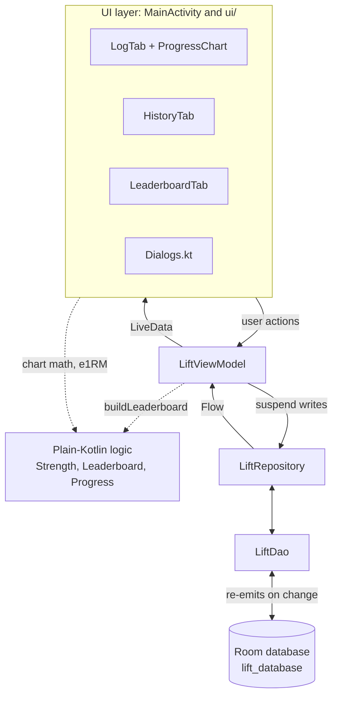
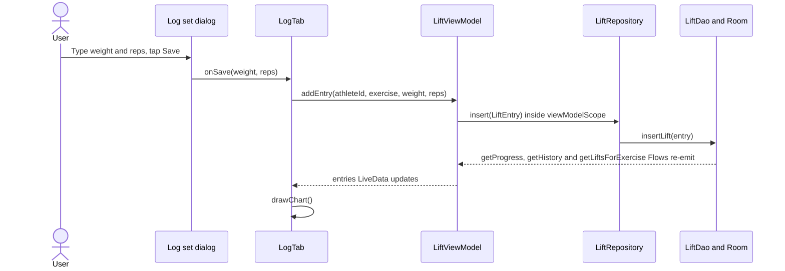

# Architecture

How MSU Lift Tracker is built: the tech stack, where each file lives, how data moves through the layers, and how theming works.

> **Path convention.** Kotlin paths are relative to `App-0.5.0/app/src/main/java/com/example/liftingapp/`. Resource paths (`res/...`) are relative to `App-0.5.0/app/src/main/`. Build files are given from `App-0.5.0/`.

---

## 1. The app in one paragraph

MSU Lift Tracker is a single-Activity Android app written in Kotlin. It uses classic Android Views with ViewBinding (not Jetpack Compose). Coaches or athletes add athletes to a roster, log sets (exercise, weight, reps), see a per-athlete progress chart, browse every logged set, and rank teammates on a leaderboard. All data is stored on the device in a Room (SQLite) database. There is no network code, no backend and no login. Those are still on the backlog (Sprint 2 Product Backlog items 3 and 4).

---

## 2. Tech stack

### 2.1 Build and platform

| Item | Value | Where it is set |
|---|---|---|
| Gradle root project name | `LIFTINGAPP` (one module: `:app`) | `settings.gradle.kts` |
| Android Gradle Plugin (`com.android.application`) | **9.4.1** | `build.gradle.kts` |
| KSP (`com.google.devtools.ksp`) | **2.3.6** (runs the Room annotation processor) | `build.gradle.kts` |
| Kotlin | No Kotlin Gradle plugin is declared. The app relies on AGP 9's built-in Kotlin support, so the Kotlin compiler version is the one AGP 9.4.1 brings in. Run `.\gradlew.bat buildEnvironment` to see the exact version. | `build.gradle.kts`, `app/build.gradle.kts` |
| Gradle wrapper | **9.6.0** (`gradle-9.6.0-bin.zip`) | `gradle/wrapper/gradle-wrapper.properties` |
| JVM for the Gradle daemon | **Java 25** (`toolchainVersion=25`, with download URLs for each OS) | `gradle/gradle-daemon-jvm.properties` |
| `compileSdk` | **37** | `app/build.gradle.kts` |
| `targetSdk` | **36** | `app/build.gradle.kts` |
| `minSdk` | **24** (Android 7.0) | `app/build.gradle.kts` |
| Java source / target compatibility | **17** (`JavaVersion.VERSION_17`) | `app/build.gradle.kts` |
| `namespace` and `applicationId` | `com.example.liftingapp` | `app/build.gradle.kts` |
| `versionCode` / `versionName` | `1` / `"1.0"` (the folder is named `App-0.5.0`; see the discrepancy list in [README.md](README.md)) | `app/build.gradle.kts` |
| Build features | `viewBinding = true` | `app/build.gradle.kts` |
| Release build | `isMinifyEnabled = false`. `app/src/main/keepRules/rules.keep` holds only the template comments. | `app/build.gradle.kts` |

`gradle.properties` sets:

| Property | Value | Meaning |
|---|---|---|
| `org.gradle.jvmargs` | `-Xmx2048m -Dfile.encoding=UTF-8` | 2 GB heap for the Gradle daemon |
| `org.gradle.configuration-cache` | `true` | Gradle's configuration cache is on |
| `kotlin.code.style` | `official` | Kotlin style for the IDE |
| `android.disallowKotlinSourceSets` | `false` | Allows Kotlin source-set registration under AGP's built-in Kotlin, which KSP uses to add Room's generated code. Leave it in place. |

**Repositories** (`settings.gradle.kts`): plugins come from `google()`, `mavenCentral()` and `gradlePluginPortal()`. Libraries come from `google()`, `mavenCentral()` and `https://jitpack.io` (needed for MPAndroidChart).

### 2.2 Libraries

All declared in `app/build.gradle.kts`.

| Dependency | Version | What the app uses it for |
|---|---|---|
| `androidx.core:core-ktx` | 1.19.1 | `SharedPreferences.edit {}`, `ResourcesCompat`, `ColorUtils`, `doAfterTextChanged`, `NestedScrollView` |
| `androidx.appcompat:appcompat` | 1.7.1 | `AppCompatActivity`, the `Spinner` style |
| `com.google.android.material:material` | 1.13.0 | Material 3 themes, `TabLayout`, `MaterialCardView`, `MaterialButtonToggleGroup`, `ExtendedFloatingActionButton`, `TextInputLayout`, `MaterialAlertDialogBuilder`, `Snackbar`, `MaterialColors` |
| `androidx.constraintlayout:constraintlayout` | 2.2.2 | Declared, but no layout uses `ConstraintLayout` today |
| `androidx.recyclerview:recyclerview` | 1.4.0 | History and Leaderboard lists |
| `androidx.room:room-runtime` | 2.8.4 | Database |
| `androidx.room:room-ktx` | 2.8.4 | `suspend` DAO methods and `Flow` queries |
| `androidx.room:room-compiler` (`ksp`) | 2.8.4 | Generates the DAO and database code at build time |
| `com.github.PhilJay:MPAndroidChart` | v3.1.0 | The progress `LineChart` on the Log tab |
| `androidx.lifecycle:lifecycle-viewmodel-ktx` | 2.11.0 | `AndroidViewModel`, `viewModelScope` |
| `androidx.lifecycle:lifecycle-livedata-ktx` | 2.11.0 | `LiveData`, `asLiveData()` |
| `junit:junit` (`testImplementation`) | 4.13.2 | Local unit tests |

Not declared directly:

- **kotlinx-coroutines** (`Flow`, `MutableStateFlow`, `launch`) arrives through Room and Lifecycle.
- **AndroidX Test** is not declared, even though `ExampleInstrumentedTest` imports it. See [Setup and Testing.md](Setup%20and%20Testing.md).
- **Jetpack Compose** is not used anywhere.

---

## 3. Files and packages

```text
com.example.liftingapp
├── MainActivity.kt          app shell, tabs, theme picker
├── LiftViewModel.kt         screen state + LeaderboardState
├── data/                    Room + plain-Kotlin logic (no Android UI)
│   ├── Athlete.kt
│   ├── LiftEntry.kt
│   ├── LiftWithAthlete.kt
│   ├── LiftDao.kt
│   ├── LiftDatabase.kt
│   ├── LiftRepository.kt
│   ├── Strength.kt
│   ├── Leaderboard.kt
│   └── Progress.kt
└── ui/                      one controller per tab + helpers
    ├── LogTab.kt
    ├── HistoryTab.kt
    ├── LeaderboardTab.kt
    ├── ProgressChart.kt
    ├── Dialogs.kt
    ├── AppTheme.kt
    ├── Format.kt
    └── Widgets.kt
```

### 3.1 Kotlin files

| File | What it does |
|---|---|
| [`MainActivity.kt`](../../App-0.5.0/app/src/main/java/com/example/liftingapp/MainActivity.kt) | The only Activity. Applies the saved theme, inflates `ActivityMainBinding`, creates the ViewModel and the three tab controllers, switches tabs, shows the theme picker, and saves the selected tab. |
| [`LiftViewModel.kt`](../../App-0.5.0/app/src/main/java/com/example/liftingapp/LiftViewModel.kt) | `LiftViewModel` (an `AndroidViewModel`) holds the picker selections and exposes `LiveData` for each tab. Also defines `LeaderboardState`. |
| [`data/Athlete.kt`](../../App-0.5.0/app/src/main/java/com/example/liftingapp/data/Athlete.kt) | Room entity for the `athletes` table. |
| [`data/LiftEntry.kt`](../../App-0.5.0/app/src/main/java/com/example/liftingapp/data/LiftEntry.kt) | Room entity for the `lift_entries` table, with the foreign key to `athletes`. |
| [`data/LiftWithAthlete.kt`](../../App-0.5.0/app/src/main/java/com/example/liftingapp/data/LiftWithAthlete.kt) | Room relation type: a set plus its athlete. |
| [`data/LiftDao.kt`](../../App-0.5.0/app/src/main/java/com/example/liftingapp/data/LiftDao.kt) | All SQL queries and writes. |
| [`data/LiftDatabase.kt`](../../App-0.5.0/app/src/main/java/com/example/liftingapp/data/LiftDatabase.kt) | The `RoomDatabase` singleton (`"lift_database"`, version 2). |
| [`data/LiftRepository.kt`](../../App-0.5.0/app/src/main/java/com/example/liftingapp/data/LiftRepository.kt) | Thin wrapper over the DAO. The single entry point for data. |
| [`data/Strength.kt`](../../App-0.5.0/app/src/main/java/com/example/liftingapp/data/Strength.kt) | `EXERCISES` list, `MAX_REPS = 20`, and `Strength.estimatedOneRepMax()` (Epley). |
| [`data/Leaderboard.kt`](../../App-0.5.0/app/src/main/java/com/example/liftingapp/data/Leaderboard.kt) | `RankBy` enum, `LeaderboardRow`, and `buildLeaderboard()`. Plain Kotlin, unit tested. |
| [`data/Progress.kt`](../../App-0.5.0/app/src/main/java/com/example/liftingapp/data/Progress.kt) | Chart math: `ChartRange`, `DayBest`, `ProgressWindow`, `localDay()`, `dailyBests()`, `progressWindow()`. Plain Kotlin, unit tested. |
| [`ui/LogTab.kt`](../../App-0.5.0/app/src/main/java/com/example/liftingapp/ui/LogTab.kt) | Log tab: athlete and exercise pickers, progress card, range buttons, Log set button, edit and delete with Undo. |
| [`ui/HistoryTab.kt`](../../App-0.5.0/app/src/main/java/com/example/liftingapp/ui/HistoryTab.kt) | History tab and its private `HistoryAdapter`. |
| [`ui/LeaderboardTab.kt`](../../App-0.5.0/app/src/main/java/com/example/liftingapp/ui/LeaderboardTab.kt) | Leaderboard tab and its private `LeaderboardAdapter` (rank badge colors). |
| [`ui/ProgressChart.kt`](../../App-0.5.0/app/src/main/java/com/example/liftingapp/ui/ProgressChart.kt) | MPAndroidChart code: `LineChart.setUpProgressChart()`, `LineChart.showProgress()`, `ProgressSummary`, and the tap tooltip `ProgressMarker`. |
| [`ui/Dialogs.kt`](../../App-0.5.0/app/src/main/java/com/example/liftingapp/ui/Dialogs.kt) | `showLogSetDialog()` (log or edit a set) and `showAddAthleteDialog()`, including input validation. |
| [`ui/AppTheme.kt`](../../App-0.5.0/app/src/main/java/com/example/liftingapp/ui/AppTheme.kt) | `AppTheme` enum (three themes) and saving the choice in `SharedPreferences`. |
| [`ui/Format.kt`](../../App-0.5.0/app/src/main/java/com/example/liftingapp/ui/Format.kt) | Display helpers: `Float.lb()`, `Float.wholeLb()`, `Float.timesBodyWeight()`, `Long.shortDateTime()`, `Long.monthDay()`, `Long.shortTime()`, `Athlete.label()`. |
| [`ui/Widgets.kt`](../../App-0.5.0/app/src/main/java/com/example/liftingapp/ui/Widgets.kt) | `spinnerAdapter()`, `Spinner.onItemSelected {}` and `View.themeColor()`. |

### 3.2 Resources

| Path | Contents |
|---|---|
| `AndroidManifest.xml` | One launcher activity, `.MainActivity`, with `windowSoftInputMode="adjustResize"`. App theme `@style/Theme.LIFTINGAPP`. Label `@string/app_name`. No permissions are requested. |
| `res/layout/activity_main.xml` | App shell: header (logo, title, palette button), `TabLayout`, and the three tab layouts `<include>`d in one `FrameLayout`. |
| `res/layout/tab_log.xml`, `tab_history.xml`, `tab_leaderboard.xml` | One layout per tab. |
| `res/layout/dialog_log_set.xml`, `dialog_add_athlete.xml` | Dialog bodies. |
| `res/layout/item_history.xml`, `item_leaderboard.xml` | List rows. |
| `res/layout/item_spinner.xml`, `item_spinner_dropdown.xml` | Themed spinner text. |
| `res/layout/chart_marker.xml` | Chart tooltip. |
| `res/values/strings.xml` | Only `app_name` (`"LIFTING APP"`), `msu_logo_description`, and `change_theme`. All other on-screen text is hard-coded in layouts and Kotlin. |
| `res/values/colors.xml` | Three palettes, prefixed `bg_` (Blue & Gold), `gr_` (Graphite) and `dl_` (Daylight). |
| `res/values/themes.xml` | Base themes, the three app themes, and component styles. |
| `res/values/type.xml` | Poppins text appearances. |
| `res/values/attrs.xml` | Custom theme attributes `cardFill`, `cardStroke`, `tabTrackFill`. |
| `res/color/segment_background.xml`, `segment_text.xml` | Checked and unchecked colors for segmented buttons. |
| `res/drawable/` | Background gradients (`bg_blue_gold`, `bg_grey_wash`, `bg_daylight`), shapes (`bg_spinner`, `bg_popup`, `bg_tab_track`, `tab_indicator_pill`, `bg_rank_badge`, `bg_chart_marker`), icons (`ic_add`, `ic_edit`, `ic_expand_more`, `ic_palette`, `ic_person_add`), the launcher icon, and `msu_logo.xml`. |
| `res/font/` | `poppins_regular.ttf`, `poppins_medium.ttf`, `poppins_bold.ttf` |
| `res/xml/backup_rules.xml`, `data_extraction_rules.xml` | Unmodified Android Studio templates. |
| `App-0.5.0/third_party/POPPINS_FONT_LICENSE.txt` | Font license notice (see section 7.3). |

---

## 4. Layers and data flow

The app follows a simple MVVM shape:

| Layer | Classes | Rule |
|---|---|---|
| UI | `MainActivity`, `LogTab`, `HistoryTab`, `LeaderboardTab`, dialogs, adapters | Observes `LiveData`, calls ViewModel methods. Never touches the DAO. |
| ViewModel | `LiftViewModel` | Holds selections in `MutableStateFlow`, turns repository `Flow`s into `LiveData`, launches writes. |
| Domain logic | `Strength`, `buildLeaderboard()`, `dailyBests()`, `progressWindow()` | Plain Kotlin with no Android imports, so it is unit tested on the JVM. |
| Repository | `LiftRepository` | Pass-through to the DAO. Future home of a backend API. |
| Data | `LiftDao`, `LiftDatabase`, `Athlete`, `LiftEntry`, `LiftWithAthlete` | Room on the device. |



User actions travel down as method calls. Data travels back up as `Flow`, which the ViewModel turns into `LiveData`. The dotted arrows are calls into plain-Kotlin logic that has no Android dependencies. The table below lists the exact methods.

### 4.1 What `LiftViewModel` exposes

| Member | Kind | Feeds |
|---|---|---|
| `athletes` | `LiveData<List<Athlete>>` | Log tab athlete picker |
| `history` | `LiveData<List<LiftWithAthlete>>` | History tab |
| `entries` | `LiveData<List<LiftEntry>>`: the selected athlete's sets for the selected exercise, oldest first. Empty when no athlete is selected. | Log tab chart |
| `leaderboard` | `LiveData<LeaderboardState>` (exercise, rank mode and rows together, so the list never shows a value with the wrong unit) | Leaderboard tab |
| `exercise`, `athleteId` | read-only getters | Log tab |
| `currentLeaderboardExercise`, `currentRankBy` | read-only getters | Leaderboard tab |
| `chartRange` | `var ChartRange`, default `ALL` | Log tab range buttons |
| `setExercise()`, `selectAthlete()` | selection setters | Log tab |
| `setLeaderboardExercise()`, `setRankBy()` | selection setters | Leaderboard tab |
| `addAthlete(name, positionGroup, bodyWeightLb, onAdded)` | write; trims the name, trims and upper-cases the position, then calls `onAdded(newId)` | Add athlete dialog |
| `addEntry(athleteId, exercise, weight, reps)` | write | Log set dialog |
| `updateEntry(entry)` | write (keeps `id` and `date`) | Edit, Undo of an edit |
| `deleteEntry(entry)` | write | Delete |
| `restoreEntry(entry)` | write (re-inserts the same row) | Undo of a delete |

### 4.2 How the reactive queries are wired

- **Log chart.** `combine(selectedAthlete, selectedExercise)` is followed by `flatMapLatest`. When either selection changes, the old query is cancelled and `repository.progressFor(id, exercise)` starts. If no athlete is selected, it emits an empty list.
- **Leaderboard.** `leaderboardExercise.flatMapLatest { repository.liftsFor(it).combine(rankByMode) {...} }`. Changing the exercise starts a new query. Changing the rank mode only re-sorts the rows already loaded, through `buildLeaderboard()`.
- **Athletes and history** are plain repository Flows turned into LiveData.

Because Room re-emits whenever a table changes, every tab updates on its own after any write. Nothing calls "refresh".

### 4.3 Walkthrough: logging a set



The History and Leaderboard tabs update from the same write, because their queries read `lift_entries` too.

---

## 5. Threading and coroutines

| Work | Where it runs | How |
|---|---|---|
| Writes (insert, update, delete) | Room's background executor | `viewModelScope.launch { ... }` calls a `suspend` DAO method. Room moves the database work off the main thread. |
| Reads | Room's background executor, results delivered on the main thread | Room `Flow` queries, collected by `asLiveData()`. |
| `onAdded(id)` after adding an athlete | Main thread | It runs inside the same `viewModelScope.launch` after `addAthlete()` returns. |
| Leaderboard ranking and chart math (`buildLeaderboard()`, `dailyBests()`, `progressWindow()`) | Main thread | They run when new data arrives. This is cheap for a team-sized roster. If data grows a lot, move it into the Flow with `flowOn(Dispatchers.Default)`. |

There are no manual threads, `AsyncTask`s or `runBlocking` calls. Writes are fire-and-forget: there is no loading or error state in the UI. The `LiftViewModel` class is annotated `@OptIn(ExperimentalCoroutinesApi::class)` because it uses `flatMapLatest`.

---

## 6. How `MainActivity` hosts the three tabs

The tabs are **not** Fragments and there is no `ViewPager`. The setup is deliberately simple:

1. `onCreate()` calls `setTheme(AppTheme.current(this).styleRes)` before `super.onCreate()`, because the theme must be set before any view is inflated.
2. `activity_main.xml` contains all three tab layouts at once, through `<include android:id="@+id/logTab" .../>`, `historyTab` and `leaderboardTab`, stacked in one `FrameLayout`. History and Leaderboard start as `gone`.
3. `MainActivity` creates `LiftViewModel` with `ViewModelProvider(this)[LiftViewModel::class.java]`.
4. It creates one plain controller class per tab and passes each one its binding and the shared ViewModel:
   - `LogTab(this, binding.logTab, viewModel)`
   - `HistoryTab(this, binding.historyTab, viewModel)`
   - `LeaderboardTab(this, binding.leaderboardTab, viewModel)`

   Each controller sets up its views and observes `LiveData` with the Activity as the `LifecycleOwner`. The Activity does not keep references to them; the listeners and observers keep them alive for the Activity's lifetime.
5. `setupTabs()` adds the tabs "Log", "History" and "Leaderboard" to the `TabLayout`. Selecting a tab sets that page to `VISIBLE` and the other two to `GONE`.
6. The selected tab index is saved under `"selected_tab"` in `onSaveInstanceState()` and restored on recreation.

**What survives what:**

| Event | Theme | Selected tab | Picker selections, chart range, rank mode | Data |
|---|---|---|---|---|
| Rotation | Yes | Yes (saved state) | Yes (ViewModel) | Yes |
| Theme change (`recreate()`) | New theme | Yes | Yes | Yes |
| App closed and reopened | Yes (SharedPreferences) | No, back to Log | No, back to the defaults | Yes |

On a fresh start the defaults are: the first athlete A to Z, exercise `"Bench"`, chart range All, leaderboard exercise `"Bench"`, ranked by Estimated max.

---

## 7. Theming

### 7.1 Themes

The palette button in the header lets the user pick one of three themes, defined in `ui/AppTheme.kt`:

| `AppTheme` entry | Label shown | Style in `res/values/themes.xml` | Base | Look |
|---|---|---|---|---|
| `BLUE_GOLD` (default) | Blue & Gold | `Theme.LIFTINGAPP.BlueGold` | `Base.Theme.LIFTINGAPP.Dark` (`Theme.Material3.Dark.NoActionBar`) | Navy gradient (`bg_wash_*`), gold `colorPrimary` `#F2B535` |
| `GRAPHITE` | Graphite | `Theme.LIFTINGAPP.Graphite` | `Base.Theme.LIFTINGAPP.Dark` | Grey gradient (`gr_wash_*`), bone-colored text `#E9E1D0` |
| `DAYLIGHT` | Daylight | `Theme.LIFTINGAPP.Daylight` | `Base.Theme.LIFTINGAPP.Light` (`Theme.Material3.Light.NoActionBar`) | Light gradient (`dl_wash_*`), navy `colorPrimary` `#1B3A6B`, gold `colorSecondary` |

- The manifest uses `Theme.LIFTINGAPP`, which is an alias for `Theme.LIFTINGAPP.BlueGold`. `MainActivity` then swaps in the saved theme.
- The choice is saved by `AppTheme.save()` in the `SharedPreferences` file `"appearance"` under the key `"theme"`. `AppTheme.current()` falls back to `BLUE_GOLD`.
- Each theme sets the full Material 3 color-role set (`colorPrimary`, `colorOnPrimary`, `colorSecondaryContainer`, `colorSurface`, `colorSurfaceContainer*`, `colorOutline`, and so on), plus three custom attributes from `res/values/attrs.xml`: `cardFill` (translucent card fill), `cardStroke` (card hairline) and `tabTrackFill` (the track behind the tab pills).
- Layouts and code never use palette colors directly. They use theme attributes (`?attr/colorPrimary`, or `View.themeColor(...)` in Kotlin), so every screen recolors when the theme changes. The chart reads its colors in `setUpProgressChart()` and `showProgress()`, which run again after `recreate()`.
- Status bar: transparent. `activity_main.xml` uses `fitsSystemWindows="true"` because `targetSdk` 36 draws edge to edge.

**To add a theme** (from the comment in `themes.xml`): add a palette to `colors.xml`, add a style in `themes.xml`, and add an entry in `ui/AppTheme.kt`.

### 7.2 Component styles

| Style | Used for |
|---|---|
| `Widget.Lifting.Card` | Translucent rounded cards (progress card, list rows). 18dp corners, 1dp stroke, no elevation. |
| `Widget.Lifting.Spinner` | Rounded dropdown fields with a chevron (`bg_spinner`, `bg_popup`). |
| `Widget.Lifting.SegmentButton` | Chart range buttons and leaderboard rank buttons. Checked state uses `colorSecondaryContainer` (see `res/color/segment_*.xml`). |

### 7.3 Fonts

- **Poppins** in three weights: `res/font/poppins_regular.ttf`, `poppins_medium.ttf`, `poppins_bold.ttf`.
- `res/values/type.xml` maps the whole Material 3 type scale to Poppins (`TextAppearance.Lifting.*`), and both base themes point at those styles. Buttons, tabs, dialogs and text fields therefore use Poppins without extra work.
- Each style sets both `android:fontFamily` and `fontFamily`, so the font also loads on Android 7 (minSdk 24) through AppCompat.
- The chart sets its own typefaces with `ResourcesCompat.getFont()` (regular for axes, legend and empty text; medium for the "Best" label).
- **License:** `App-0.5.0/third_party/POPPINS_FONT_LICENSE.txt` says "Copyright 2020 The Poppins Project Authors (https://github.com/itfoundry/Poppins)" and that the font is licensed under the **SIL Open Font License, Version 1.1**. The file is a short notice that links to the full license text at https://openfontlicense.org.

### 7.4 Logo

`res/drawable/msu_logo.xml` is a **placeholder** vector (a circle with a dumbbell, tinted `?attr/colorPrimary`). Its header comment explains how to replace it with the official Montana State University logo, as a PNG in `drawable-nodpi/` or through Android Studio's Vector Asset tool. The header keeps the logo 48dp tall. The launcher icon (`res/mipmap-*`) is still the default Android Studio icon.

---

## 8. Common changes

| Task | Where |
|---|---|
| Add an exercise | Append it to `EXERCISES` in `data/Strength.kt`. It appears in both pickers. Don't rename existing names; they are stored as text in `lift_entries.exercise`. |
| Change the rep cap | `MAX_REPS` in `data/Strength.kt`. The dialog's helper text and error message use it. |
| Change the e1RM formula | `Strength.estimatedOneRepMax()` in `data/Strength.kt`. Update `StrengthTest`, plus the expected values in `LeaderboardTest` and `ProgressTest`. |
| Add a chart range | Add an entry to `ChartRange` in `data/Progress.kt`, a button in `res/layout/tab_log.xml`, and a mapping in `rangeButtons` in `ui/LogTab.kt`. |
| Add a theme | See section 7.1. |
| Change the schema | See the checklist in [Database.md](Database.md#9-checklist-changing-the-schema). |
