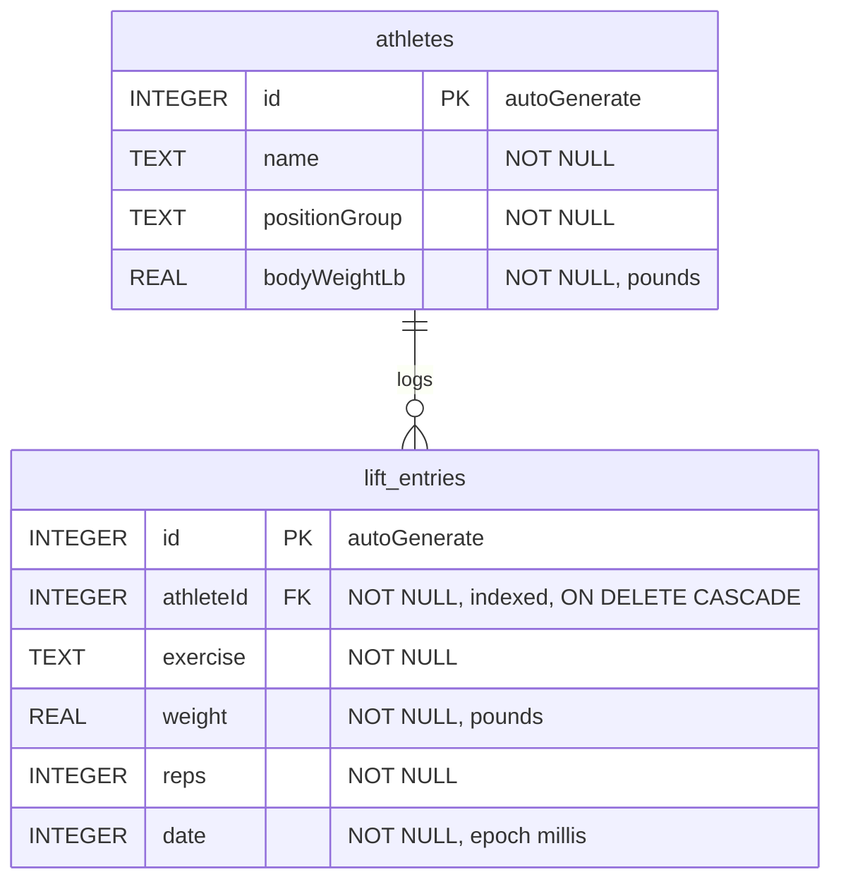

# Database

How MSU Lift Tracker stores data on the device: the Room database, its two tables, the DAO queries, the repository, and the rules that keep the data valid.

> **Path convention.** Kotlin paths are relative to `App-0.5.0/app/src/main/java/com/example/liftingapp/`. Resource paths (`res/...`) are relative to `App-0.5.0/app/src/main/`.

---

## 1. Overview

| Setting | Value | Source |
|---|---|---|
| Library | Room 2.8.4 (`room-runtime`, `room-ktx`, `room-compiler` through KSP) | `App-0.5.0/app/build.gradle.kts` |
| Database class | `LiftDatabase` (extends `RoomDatabase`) | `data/LiftDatabase.kt` |
| Database file name | `"lift_database"` | `data/LiftDatabase.kt` |
| Schema version | `2` | `@Database(..., version = 2, ...)` |
| Entities | `Athlete` (table `athletes`), `LiftEntry` (table `lift_entries`) | `data/Athlete.kt`, `data/LiftEntry.kt` |
| DAO | `LiftDao` (one DAO for everything) | `data/LiftDao.kt` |
| Schema export | Off (`exportSchema = false`) | `data/LiftDatabase.kt` |
| Migrations | None written | |
| Migration fallback | `.fallbackToDestructiveMigration(dropAllTables = true)` | `data/LiftDatabase.kt` |
| Where it lives | Only on the phone. There is no server, no sync, and no login. | Sprint 2 Product Backlog items 3 and 4 (still not started) |

### How the database is opened

`LiftDatabase.getDatabase(context)` is a thread-safe singleton:

- It keeps one instance in a `@Volatile private var INSTANCE`.
- It builds the database inside `synchronized(this)` the first time.
- It always uses `context.applicationContext`, so it never holds on to an Activity.

The only caller is `LiftViewModel` (`LiftViewModel.kt`), which passes the `Application`.

### What "destructive migration" means for you

The code comment in `data/LiftDatabase.kt` says the schema went from version 1 to version 2 when a new table and new columns were added. No `Migration` was written. Instead, Room is told to **drop every table and start empty** whenever the stored version does not match the code.

- During development this is fine. Installing a build with a new version number wipes your test data.
- Before real athletes use the app, replace it with a proper `Migration`. The code comment says the same thing.
- Because `exportSchema = false`, there is no schema JSON history in the repo. The old version 1 schema is not recorded anywhere in the code.

---

## 2. Entity-relationship diagram



One athlete has zero or more logged sets. Every set belongs to exactly one athlete.

---

## 3. Tables

SQL types below are the types Room maps the Kotlin types to: `Long` and `Int` become `INTEGER`, `Float` becomes `REAL`, `String` becomes `TEXT`. Every column is non-null, because none of the Kotlin properties are nullable.

### 3.1 `athletes`: entity `Athlete`

Source: `data/Athlete.kt`. One row per athlete on the roster.

| Column (Kotlin name) | Kotlin type | SQL type | Null? | Default | Notes |
|---|---|---|---|---|---|
| `id` | `Long` | INTEGER | No | `0` in Kotlin | `@PrimaryKey(autoGenerate = true)`. Passing `0` lets SQLite assign the next id. |
| `name` | `String` | TEXT | No | none | Trimmed before saving (see section 7). Not unique, so two athletes can have the same name. |
| `positionGroup` | `String` | TEXT | No | none | For example `"OL"`, `"WR"`, `"DB"`. Trimmed and upper-cased before saving. Stored now so position-group benchmarking can use it later (Sprint 2 Product Backlog item 10). |
| `bodyWeightLb` | `Float` | REAL | No | none | Body weight in pounds. Used for pound-for-pound ranking. |

- Indices: none besides the primary key.
- Foreign keys: none.
- Body weight is a single current value. There is no body-weight history.

### 3.2 `lift_entries`: entity `LiftEntry`

Source: `data/LiftEntry.kt`. One row per logged set.

| Column (Kotlin name) | Kotlin type | SQL type | Null? | Default | Notes |
|---|---|---|---|---|---|
| `id` | `Long` | INTEGER | No | `0` in Kotlin | `@PrimaryKey(autoGenerate = true)`. |
| `athleteId` | `Long` | INTEGER | No | none | Foreign key to `athletes.id`. Indexed. |
| `exercise` | `String` | TEXT | No | none | The exercise's display name, for example `"Bench"` or `"Power Clean"`. The app only offers names from `EXERCISES` in `data/Strength.kt`. |
| `weight` | `Float` | REAL | No | none | Pounds. Decimals are allowed (for example 227.5). |
| `reps` | `Int` | INTEGER | No | none | 1 to 20 when entered through the app (see section 7). |
| `date` | `Long` | INTEGER | No | `System.currentTimeMillis()` in Kotlin | Epoch milliseconds (the Sprint 1 timesheet records this choice "for easier sorting later"). |

**Foreign key** (declared in the `@Entity` annotation):

| Child column | Parent | `onDelete` | `onUpdate` |
|---|---|---|---|
| `lift_entries.athleteId` | `athletes.id` | `ForeignKey.CASCADE`: deleting an athlete deletes all of their sets | not set (Room's default, no action) |

**Index:** `Index("athleteId")`. It speeds up the per-athlete queries and the foreign-key checks. Room names it `index_lift_entries_athleteId`.

**About the Kotlin defaults.** The defaults for `id` and `date` are Kotlin constructor defaults, not SQL `DEFAULT` clauses. `date` is stamped at the moment the `LiftEntry` object is created in `LiftViewModel.addEntry()`. Editing a set uses `copy(weight = ..., reps = ...)`, so the original `id` and `date` are kept.

> **Heads-up: exercise names are stored as plain text.** If you rename an entry in `EXERCISES` (for example `"Bench"` to `"Bench Press"`), old rows keep the old name and stop showing up under the new one. Add new names; don't rename existing ones unless you also update the rows.

---

## 4. Relation: `LiftWithAthlete`

Source: `data/LiftWithAthlete.kt`. This is not a table. It is a result type that pairs a set with the athlete who did it.

```kotlin
data class LiftWithAthlete(
    @Embedded val lift: LiftEntry,
    @Relation(parentColumn = "athleteId", entityColumn = "id")
    val athlete: Athlete
)
```

- `@Embedded` reads the `lift_entries` columns into `lift`.
- `@Relation` makes Room run a second query on `athletes`, matching `lift.athleteId` to `athletes.id`, and fill in `athlete`.
- Because Room runs two queries, any DAO method that returns this type is marked `@Transaction`, so both reads see the same data.
- It is used by the History tab (every set, with the athlete's name) and the Leaderboard (every set for one exercise, with body weight).

---

## 5. DAO: `LiftDao`

Source: `data/LiftDao.kt`. Reads return `Flow`, and Room re-emits a new list whenever a table the query reads from changes. Writes are `suspend` functions, so they never run on the main thread.

| Method | Annotation / SQL | Returns | Used by |
|---|---|---|---|
| `insertAthlete(athlete: Athlete)` | `@Insert` (default conflict strategy, `ABORT`) | `Long`: the new row id | `LiftRepository.addAthlete()` |
| `getAthletes()` | `SELECT * FROM athletes ORDER BY name COLLATE NOCASE` | `Flow<List<Athlete>>`, sorted A to Z ignoring case | Log tab athlete picker |
| `insertLift(entry: LiftEntry)` | `@Insert` (`ABORT`) | `Unit` | Logging a new set, and Undo after a delete (re-inserts the same `id` and `date`) |
| `updateLift(entry: LiftEntry)` | `@Update`, matches on the primary key `id` | `Unit` | Editing a set, and Undo after an edit |
| `deleteLift(entry: LiftEntry)` | `@Delete`, matches on the primary key `id` | `Unit` | Deleting a set |
| `getProgress(athleteId: Long, exercise: String)` | `SELECT * FROM lift_entries WHERE athleteId = :athleteId AND exercise = :exercise ORDER BY date ASC` | `Flow<List<LiftEntry>>`, oldest first | Log tab progress chart |
| `getHistory()` | `@Transaction` `SELECT * FROM lift_entries ORDER BY date DESC` | `Flow<List<LiftWithAthlete>>`, newest first | History tab |
| `getLiftsForExercise(exercise: String)` | `@Transaction` `SELECT * FROM lift_entries WHERE exercise = :exercise` | `Flow<List<LiftWithAthlete>>`, no `ORDER BY` (sorted later in Kotlin) | Leaderboard tab |

Not in the DAO: there is no method to update or delete an athlete. The cascade rule exists in the schema, but no code path in the app deletes an athlete today.

---

## 6. Repository: `LiftRepository`

Source: `data/LiftRepository.kt`. A thin wrapper around `LiftDao`. Its own comment calls it "the single place the rest of the app goes for data" and the place where a backend API would plug in later. It adds no caching or logic.

| Member | Type / signature | Calls |
|---|---|---|
| `athletes` | `val athletes: Flow<List<Athlete>>` | `dao.getAthletes()` |
| `history` | `val history: Flow<List<LiftWithAthlete>>` | `dao.getHistory()` |
| `progressFor(athleteId, exercise)` | `fun progressFor(athleteId: Long, exercise: String): Flow<List<LiftEntry>>` | `dao.getProgress(...)` |
| `liftsFor(exercise)` | `fun liftsFor(exercise: String): Flow<List<LiftWithAthlete>>` | `dao.getLiftsForExercise(...)` |
| `addAthlete(name, positionGroup, bodyWeightLb)` | `suspend fun ...: Long` | Builds an `Athlete` and calls `dao.insertAthlete(...)`. Returns the new id. |
| `insert(entry)` | `suspend fun insert(entry: LiftEntry)` | `dao.insertLift(entry)` |
| `update(entry)` | `suspend fun update(entry: LiftEntry)` | `dao.updateLift(entry)` |
| `delete(entry)` | `suspend fun delete(entry: LiftEntry)` | `dao.deleteLift(entry)` |

`LiftViewModel` (`LiftViewModel.kt`) creates the one repository instance and is its only user. See [Architecture.md](Architecture.md) for how the ViewModel turns these Flows into LiveData.

---

## 7. Data-integrity rules

Most validation happens in the UI dialogs, not in the database. The database itself only enforces types, non-null columns, primary keys and the foreign key. If you add a new way to write data (an import, a backend sync, a test fixture), you must apply the UI rules yourself.

| Rule | Enforced where | Layer |
|---|---|---|
| Reps must be a whole number from 1 to `MAX_REPS` (20). Above 20 the e1RM estimate is unreliable (Sprint 2 decision, 9/27/2026). | `showLogSetDialog()` in `ui/Dialogs.kt`: Save stays disabled and the field shows "Enter 1–20 reps". `MAX_REPS` is defined in `data/Strength.kt`. | UI only |
| Reps must be at least 1 for any e1RM calculation. | `Strength.estimatedOneRepMax()` in `data/Strength.kt` calls `require(reps >= 1)` and throws `IllegalArgumentException` otherwise. Covered by `StrengthTest.zeroRepsIsRejected`. The upper cap of 20 is **not** checked here. | Domain logic |
| Set weight must parse as a number greater than 0. | `showLogSetDialog()` in `ui/Dialogs.kt` (`takeIf { it > 0f }`). The field's `inputType="numberDecimal"` in `res/layout/dialog_log_set.xml` has no minus key. There is no upper limit. | UI only |
| Athlete name and position group must not be blank. | `showAddAthleteDialog()` in `ui/Dialogs.kt`: the Add button stays disabled. | UI only |
| Name is trimmed. Position group is trimmed and upper-cased. | `LiftViewModel.addAthlete()` in `LiftViewModel.kt` | ViewModel |
| Body weight must parse as a number greater than 0. This matters because pound-for-pound divides by it. | `showAddAthleteDialog()` in `ui/Dialogs.kt` | UI only |
| Exercise must be one of `EXERCISES` (`"Bench"`, `"Squat"`, `"Deadlift"`, `"Power Clean"`, `"Pull-ups"`, `"Push-ups"`). | The exercise spinners only offer that list (`ui/LogTab.kt`, `ui/LeaderboardTab.kt`). The column itself accepts any text. | UI only |
| Every set must belong to an existing athlete. | Foreign key `lift_entries.athleteId` to `athletes.id`. The Log set button opens the Add athlete dialog instead when no athlete is selected (`LogTab.onAddSetClicked()`). | Database + UI |
| Deleting an athlete deletes their sets. | `onDelete = ForeignKey.CASCADE` in `data/LiftEntry.kt`. No feature deletes athletes yet. | Database |
| A set's date is set once, when it is logged. Edits keep the original date and id. | `LiftEntry.date` default in `data/LiftEntry.kt`. `LogTab.editSet()` uses `original.copy(weight = weight, reps = reps)`. | Model + UI |
| Undo of a delete restores the exact same row. | `LiftViewModel.restoreEntry()` re-inserts the deleted `LiftEntry` with its old `id` and `date`. | ViewModel |
| Saving an edit with no changes writes nothing. | `LogTab.editSet()` returns early if weight and reps are unchanged. | UI |

---

## 8. Other data the app stores

| What | Where | Details |
|---|---|---|
| Chosen color theme | `SharedPreferences` file `"appearance"`, key `"theme"` | Holds the `AppTheme` enum name (`BLUE_GOLD`, `GRAPHITE` or `DAYLIGHT`). Read and written by `ui/AppTheme.kt`. If nothing is saved, the app uses `BLUE_GOLD`. |
| Selected tab | `Bundle` key `"selected_tab"` | Saved in `MainActivity.onSaveInstanceState()`. Survives rotation and theme changes, not a full app restart. |
| Picker selections and chart range | `LiftViewModel` fields | Kept in memory only. They survive rotation and theme changes, not a full app restart. |

**Backups.** `AndroidManifest.xml` sets `android:allowBackup="true"`. The rule files `res/xml/backup_rules.xml` and `res/xml/data_extraction_rules.xml` are still the unmodified Android Studio templates, so they add no include or exclude rules.

---

## 9. Checklist: changing the schema

1. Change the entity in `data/Athlete.kt` or `data/LiftEntry.kt` (or add a new entity to the `entities` list in `data/LiftDatabase.kt`).
2. Bump `version` in the `@Database` annotation.
3. Today, the next launch wipes all data because of `fallbackToDestructiveMigration(dropAllTables = true)`. Once real data matters, write a `Migration(old, new)` and add it with `.addMigrations(...)` in `LiftDatabase.getDatabase()`.
4. Consider turning `exportSchema` on (and pointing KSP's `room.schemaLocation` at a folder in the repo) so each version's schema is kept for migrations and reviews.
5. Update this document and the ER diagram.
