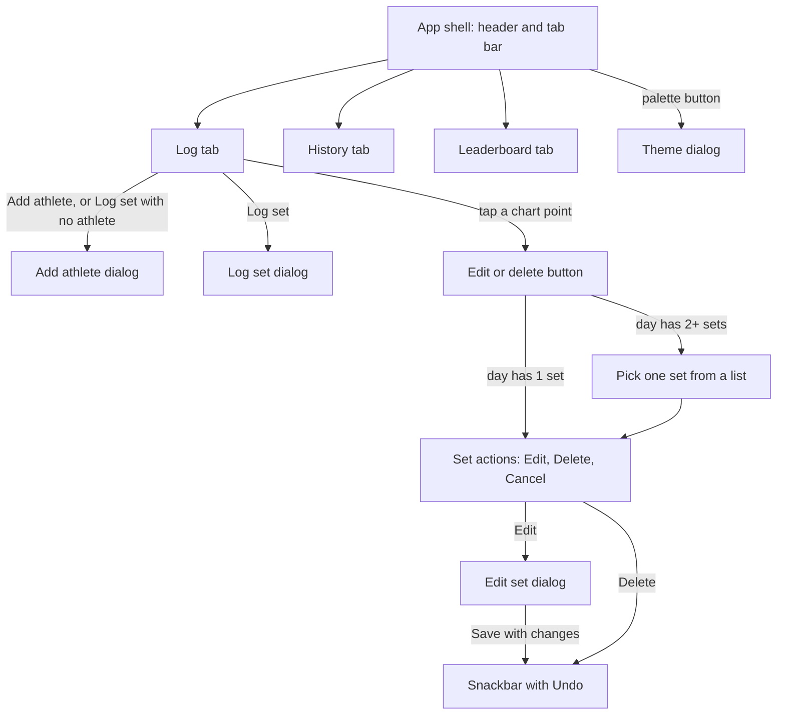

# User Experience

What a user sees and can do in MSU Lift Tracker, screen by screen, with the exact on-screen text and the math behind every number.

> **Path convention.** Kotlin paths are relative to `App-0.5.0/app/src/main/java/com/example/liftingapp/`. Resource paths (`res/...`) are relative to `App-0.5.0/app/src/main/`.
>
> **About the on-screen text.** `res/values/strings.xml` holds only three strings (`app_name`, `msu_logo_description`, `change_theme`). Every other label and message is hard-coded in the layouts or in Kotlin. The quotes below are copied from those files. `{braces}` mark values filled in at runtime.

---

## 1. Screen map

The app has one screen: a header, a tab bar, and three tabs. Everything else is a dialog or a snackbar.



---

## 2. App shell

Layout: `res/layout/activity_main.xml`. Code: `MainActivity.kt`.

| Element | What the user sees |
|---|---|
| Logo | A placeholder badge (`res/drawable/msu_logo.xml`), 48dp tall. Screen readers announce "Montana State University logo". The real logo has not been added yet. |
| Title | **LIFTING APP** (`@string/app_name`). The launcher label uses the same string. |
| Palette button | Top right. Screen readers announce "Change theme". Opens the theme dialog (section 7). |
| Tab bar | Pill-style tabs: **Log**, **History**, **Leaderboard**. The selected tab gets a sliding pill in `colorPrimary`. |

The app opens on the Log tab. Rotating the phone or changing the theme keeps the current tab.

---

## 3. Log tab

Layout: `res/layout/tab_log.xml`. Code: `ui/LogTab.kt`, `ui/ProgressChart.kt`, `ui/Dialogs.kt`.

### 3.1 What is on the screen (top to bottom)

| Element (view id) | Shows |
|---|---|
| "Athlete" label (`athleteLabel`) | Field label. |
| Athlete picker (`athleteSpinner`) | Every athlete as **{name} ({POSITION})**, for example "Jordan Smith (OL)", sorted A to Z ignoring case. |
| Empty-roster text (`noAthletesText`) | **"No athletes yet. Add one to start logging."** It replaces the picker while the roster is empty. |
| **Add athlete** button (`addAthleteButton`) | Opens the Add athlete dialog. |
| Exercise picker (`exerciseSpinner`) | **Bench, Squat, Deadlift, Power Clean, Pull-ups, Push-ups** (from `EXERCISES` in `data/Strength.kt`). Starts on Bench. |
| Set count (`chartCaption`) | Empty, **"1 set"**, or **"{n} sets"**. Counts **all** of this athlete's sets for this exercise, not only the ones in the chosen range. |
| Progress card (`chartContainer`) | "Best est. max" with a big number (`bestMaxText`), a change figure on the right (`changeGroup`), the chart (`liftChart`), the range buttons (`rangeToggle`), and the edit button (`editSetButton`). |
| Status line (`lastSavedText`) | The result of the last save, edit, delete or undo (section 3.6). Empty until then. |
| **Log set** button (`addWeightFab`) | Floating button at the bottom right. Screen readers announce "Log a set". |

### 3.2 Flow: add an athlete

1. Tap **Add athlete**. (Tapping **Log set** while no athlete is selected opens the same dialog.)
2. The **Add athlete** dialog shows three fields:
   - **Name**: the keyboard capitalizes each word.
   - **Position group (e.g. OL, WR)**: the keyboard types capitals.
   - **Body weight (lb)**: a number pad that allows decimals.
3. The **Add** button stays disabled until the name and position are not blank **and** the body weight is a number greater than 0. No error text is shown; the button simply stays grey.
4. Tap **Add**. The app trims the name, trims and upper-cases the position, and saves the athlete. The dialog closes and the new athlete becomes the selected athlete.
5. **Cancel** closes the dialog without saving.

Things the app does **not** do yet: edit an athlete, change their body weight, or delete an athlete. Two athletes may have the same name.

### 3.3 Flow: log a set

1. Pick the athlete and the exercise.
2. Tap **Log set**.
3. The dialog title reads **"Log {exercise} for {athlete name}"**, for example "Log Bench for Jordan Smith". It has two fields:
   - **Weight (lb)**: decimals allowed, no minus key.
   - **Reps**: whole numbers, with the helper text **"1–20"**.
4. As you type:
   - **Save** is enabled only when the weight is greater than 0 and the reps are 1 to 20.
   - If the reps field is not empty and the value is outside 1 to 20, the field shows the error **"Enter 1–20 reps"**.
   - Once both fields are valid, a live preview appears: **"Estimated 1RM: {n} lb"**. For 225 lb × 5 it reads "Estimated 1RM: 263 lb".
5. Tap **Save**. The set is saved with the current date and time. The dialog closes and the status line reads **"Saved {athlete}: {exercise} {weight} × {reps}"**, for example "Saved Jordan Smith: Bench 225 × 5".
6. The chart, the History tab and the Leaderboard all update right away.

### 3.4 Flow: read the progress chart

The chart shows **one athlete, one exercise**, with **one point per training day**.

| Part | Meaning |
|---|---|
| **Est. max** (solid line, filled underneath) | The best estimated one-rep max of that day. |
| **Heaviest set** (dashed line) | The heaviest weight lifted that day, whatever the reps. |
| Legend | Top left: "Heaviest set" and "Est. max". |
| Dashed horizontal line labeled **"Best {n}"** | The highest Est. max in view. |
| X axis | Real dates, so gaps between sessions show as gaps. Labels look like "Sep 22". If the view spans more than 300 days they look like "Sep '26". |
| Y axis | Whole pounds, zoomed out on purpose so small changes don't look like big swings (see section 8.3). |
| Range buttons | **1M**, **3M**, **6M**, **1Y**, **All**. One is always selected. All is the default. Every range ends today. |
| "Best est. max" header | The Est. max of the best day in view, for example "239 lb". Shows "—" when nothing is in view. |
| Change header | **"Since {first day in view}"** with **"+{n} lb"**. Hidden when only one day is in view. See section 8.3 for what it measures. |

Chart behavior:

- **Drag** sideways to pan. **Pinch** to zoom the time axis, down to 7 days across. Vertical swipes scroll the page. Double-tap zoom is turned off.
- Every redraw (new data, new range) resets the zoom.
- Point circles are hidden when more than 45 points (training days) are in view. Calendar days with no sets don't count.
- **Tap a point** on the Est. max line to see a tooltip:

  ```text
  {Weekday, Mon d, yyyy}
  Est. max {n} lb ({weight} × {reps})
  Heaviest set {n} lb
  ```

  The third line appears only when the day's heaviest set is heavier than the set that produced the best estimate. Points on the Heaviest set line can't be selected; the Est. max tooltip already covers both.

### 3.5 Flow: edit or delete a set

Sets are edited from the chart, not from the History tab.

1. Tap a point on the chart. A button appears under the range buttons: **"Edit or delete set from {Mon d}"**, or **"Edit or delete sets from {Mon d}"** when that day has more than one set. Tapping the same point again hides it, and so does any redraw of the chart (new data or a new range).
2. Tap the button.
   - **One set that day:** the set's action dialog opens directly.
   - **Several sets that day:** a list titled **"{exercise} sets on {Mon d}"** shows each set, oldest first, as **"{weight} lb × {reps}  (est. {n} lb)  {time}"**. Tap one, or **Cancel**.
3. The action dialog is titled **"{exercise}, {Mon d} at {time}"**, with the message **"{weight} lb × {reps} (est. max {n} lb)"**, and three buttons: **Edit**, **Delete**, **Cancel**.
4. **Edit** reopens the log dialog, titled **"Edit {exercise} for {athlete}"**, with the weight and reps filled in. The same validation applies.
   - If you save without changing anything, nothing is written.
   - Otherwise the set is updated, the status line reads **"Updated {athlete}: {exercise} {weight} × {reps}"**, and a snackbar says **"Changed to {weight} × {reps}"** with an **Undo** action.
   - Only weight and reps can change. The exercise, athlete, date and time stay the same.
5. **Delete** removes the set immediately, without a confirmation step. The status line reads **"Deleted {athlete}: {exercise} {weight} × {reps}"**, and a snackbar says **"Deleted {weight} × {reps}"** with **Undo**.
6. **Undo** puts the set back exactly as it was, with the same date. The status line reads **"Restored {athlete}: {exercise} {weight} × {reps}"**.

Snackbars use the long duration and sit above the Log set button.

### 3.6 Log tab messages

| Situation | Text | Where |
|---|---|---|
| Roster is empty | "No athletes yet. Add one to start logging." | `noAthletesText` in `tab_log.xml` |
| Chart, no athlete selected | "Add an athlete to start logging." | `LogTab.drawChart()` |
| Chart, athlete has no sets for this exercise | "No {exercise} sets yet. Tap Log set to add one." | `LogTab.drawChart()` |
| Chart, sets exist but none in the chosen range | "No {exercise} sets in the last {month / 3 months / 6 months / year}. Tap All to see every set." | `LogTab.drawChart()` with `ChartRange.phrase` |
| After saving | "Saved {athlete}: {exercise} {weight} × {reps}" | `LogTab.onAddSetClicked()` |
| After editing | "Updated {athlete}: {exercise} {weight} × {reps}" | `LogTab.editSet()` |
| After deleting | "Deleted {athlete}: {exercise} {weight} × {reps}" | `LogTab.deleteSet()` |
| After an undo | "Restored {athlete}: {exercise} {weight} × {reps}" | `LogTab.editSet()`, `LogTab.deleteSet()` |

---

## 4. History tab

Layout: `res/layout/tab_history.xml`, `res/layout/item_history.xml`. Code: `ui/HistoryTab.kt`.

- Lists **every set** for every athlete and exercise, **newest first**.
- Each row is a card:

  | Position | Content | Example |
  |---|---|---|
  | Title | Athlete name (no position) | Jordan Smith |
  | Detail | "{exercise}, {weight} lb × {reps}" | Bench, 205 lb × 4 |
  | Date | Date and time in the phone's short format | 9/29/26, 6:15 PM (US English) |
  | Right side | Estimated max, with the caption "est. max" | 232 lb |

- Empty state: **"No sets logged yet. Log one from the Log tab."**
- The list is read-only. Tapping a row does nothing. To fix a set, use the chart on the Log tab.

---

## 5. Leaderboard tab

Layout: `res/layout/tab_leaderboard.xml`, `res/layout/item_leaderboard.xml`. Code: `ui/LeaderboardTab.kt`, `data/Leaderboard.kt`.

### 5.1 Controls

- **Exercise picker**: same six exercises. It is separate from the Log tab's picker. Starts on Bench.
- **Rank toggle**: **Estimated max** | **Pound-for-pound**. One is always selected. Starts on Estimated max.

### 5.2 Rows

- Each athlete appears **once**, using their single best set for the chosen exercise. "Best" always means the highest estimated max, in both modes.
- Athletes with no sets for that exercise are left out.

| Part | Content | Example |
|---|---|---|
| Rank badge | 1, 2, 3, ... | 1 |
| Name | "{name} ({POSITION})" | Alex Carter (OL) |
| Detail | "Best set {weight} × {reps} · BW {body weight} lb" | Best set 315 × 3 · BW 285 lb |
| Value, Estimated max mode | "{n} lb" | 347 lb |
| Value, Pound-for-pound mode | "{ratio}× BW", two decimals | 1.22× BW |

- Badge colors (`LeaderboardAdapter`): 1st place uses the theme's `colorOnPrimary` for both the circle and the number; 2nd and 3rd use `colorSecondaryContainer` with `colorOnSecondaryContainer`; the rest use `cardStroke` with `colorOnSurfaceVariant`. (The code comments describe 1st place as gold. See the discrepancy list in [README.md](README.md).)
- There is no tie-breaker. Tied athletes keep the order the query returned them in, and that query has no `ORDER BY`.
- Empty state: **"No {exercise} sets logged yet."**, for example "No Squat sets logged yet."

---

## 6. Validation rules at a glance

| Field | Rule | What the user sees when it fails | Code |
|---|---|---|---|
| Weight (lb), log or edit | A number greater than 0 | Save stays disabled | `showLogSetDialog()` in `ui/Dialogs.kt` |
| Reps, log or edit | A whole number from 1 to 20 (`MAX_REPS`) | Save stays disabled. Error "Enter 1–20 reps" once something is typed. Helper text "1–20". | `showLogSetDialog()` |
| Name, add athlete | Not blank | Add stays disabled | `showAddAthleteDialog()` in `ui/Dialogs.kt` |
| Position group, add athlete | Not blank | Add stays disabled | `showAddAthleteDialog()` |
| Body weight (lb), add athlete | A number greater than 0 | Add stays disabled | `showAddAthleteDialog()` |
| Log set with no athlete | An athlete must be selected | The Add athlete dialog opens instead | `LogTab.onAddSetClicked()` |

Invalid input never closes a dialog: the Save and Add buttons have their own click handlers that only run when the input parses.

---

## 7. Theme switcher

1. Tap the **palette** button in the header.
2. A dialog titled **"Theme"** lists **Blue & Gold**, **Graphite** and **Daylight**, with the current one checked.
3. Tap a theme. The dialog closes. If you picked a different theme, the app saves it and rebuilds the screen in the new colors. The current tab, pickers, chart range and data stay as they were.
4. The choice is remembered the next time the app opens. New installs start on Blue & Gold.

| Theme | Look |
|---|---|
| Blue & Gold (default) | Dark navy gradient with a gold accent |
| Graphite | Dark grey gradient with bone-colored text |
| Daylight | Light background with navy and gold, for bright weight rooms |

Details are in [Architecture.md](Architecture.md#7-theming).

---

## 8. The numbers the app shows

### 8.1 Estimated one-rep max (Epley)

Implemented in `Strength.estimatedOneRepMax(weight, reps)` in `data/Strength.kt`:

```text
if reps == 1:  e1RM = weight
otherwise:     e1RM = weight × (1 + reps / 30)
reps < 1  ->   IllegalArgumentException ("reps must be at least 1")
```

- Calculated in `Float`. It is never stored; every screen calculates it from the saved weight and reps.
- Shown rounded to the nearest whole pound (`Float.wholeLb()` in `ui/Format.kt`; halves round up).
- Only Epley is implemented. Brzycki was considered in the backlog but not added (Sprint 2 Product Backlog item 6).
- Reps are capped at 20 in the log dialog because the estimate becomes unreliable at high reps.

| Set | Math | Shown |
|---|---|---|
| 335 × 1 | single rep, so the weight itself | 335 lb |
| 225 × 5 | 225 × (1 + 5/30) = 262.5 | 263 lb |
| 315 × 3 | 315 × (1 + 3/30) = 346.5 | 347 lb |

> **Float rounding gotcha for test writers.** Some results that are exactly ".5" on paper come out a hair lower in `Float`. For example, 195 × 5 is 227.5 on paper but `Float` gives 227.49998, so the app shows "227 lb". Use a tolerance in assertions, as the existing tests do.

### 8.2 Pound-for-pound

Implemented in `buildLeaderboard()` in `data/Leaderboard.kt`:

```text
poundForPound = e1RM of the athlete's best set ÷ athlete's bodyWeightLb
```

- Shown with two decimals and "× BW" (`Float.timesBodyWeight()` in `ui/Format.kt`). 1.48× BW means the estimated max is 1.48 times the athlete's body weight.
- It uses the body weight stored on the athlete today. There is no body-weight history, so old sets are divided by the current weight.
- Wilks-style scoring is not implemented; the backlog notes it could replace this later (Sprint 2 Product Backlog item 13).

**Worked example: Bench leaderboard** (names are made up):

| Athlete | Body weight | Sets logged | e1RM per set | Best set | Estimated max | Pound-for-pound |
|---|---|---|---|---|---|---|
| Alex Carter (OL) | 285 lb | 315 × 3, 335 × 1 | 346.5, 335 | 315 × 3 | **347 lb** | 346.5 ÷ 285 = **1.22× BW** |
| Sam Lee (DB) | 180 lb | 250 × 2 | 266.67 | 250 × 2 | **267 lb** | 266.67 ÷ 180 = **1.48× BW** |

- **Estimated max** order: 1. Alex Carter (347 lb), 2. Sam Lee (267 lb).
- **Pound-for-pound** order: 1. Sam Lee (1.48× BW), 2. Alex Carter (1.22× BW).
- Alex's best set is 315 × 3, even though 335 × 1 is heavier, because its estimate is higher. `LeaderboardTest` checks this same situation.

### 8.3 The progress chart series

The math lives in `data/Progress.kt` (plain Kotlin, unit tested by `ProgressTest`). The drawing lives in `LineChart.showProgress()` in `ui/ProgressChart.kt`.

1. **Calendar day.** `localDay(millis)` turns a timestamp into a day number in the phone's time zone: `(millis + time-zone offset) ÷ 86,400,000`, rounded down. A set logged at 8 pm in Montana counts for that evening's date, not the next UTC day.
2. **One point per day.** `dailyBests(entries)` groups the sets by day. For each day it keeps:
   - `bestSet`: the set with the highest e1RM,
   - `bestE1rm`: that e1RM (the **Est. max** line),
   - `heaviest`: the heaviest weight that day (the **Heaviest set** line).

   Days are sorted oldest first.
3. **Which days are shown.** `progressWindow(days, range, today)`:
   - The window ends at `end = max(today, last training day)`.
   - **1M / 3M / 6M / 1Y** start at `end − (N − 1)`, where N is 30, 91, 182 or 365 days.
   - **All** starts at the first training day, or 13 days before `end`, whichever is earlier. So the All view always spans at least 14 days (`MIN_SPAN_DAYS`) and a couple of sessions don't get stretched edge to edge.
   - Only days on or after the start are drawn.
4. **Axes** (`showProgress()`):
   - X is "days since the window start", padded by `max(0.6, 3% of the span)` on each side so edge points aren't clipped.
   - Y: `low` = smallest Heaviest set in view, `high` = largest Est. max in view, `headroom = max(20% of high, 20 lb)`, `step = 50` if `high ≥ 400`, otherwise `25`.
   - Y minimum = `max(0, floor((low − headroom) ÷ step) × step)`.
   - Y maximum = `ceil((high + 0.6 × headroom) ÷ step) × step`.
5. **Header numbers** (`ProgressSummary`):
   - **Best est. max** = the highest `bestE1rm` among the days in view.
   - **Since {date}** = the first day in view.
   - **Change** = best day's `bestE1rm` − first day's `bestE1rm`. It is only shown when at least 2 days are in view.
   - Because "best" is the maximum over the same days, this number is **never negative**. It means "how far the best day in view is above the first day in view", not "latest session compared with the first". The minus-sign branch in `LogTab.drawChart()` can't be reached with the current formula.

**Worked example: Jordan Smith, Bench** (made-up data; assume today is Wednesday, October 14, 2026):

| Date | Sets logged | e1RM per set | Day's Est. max | Day's Heaviest set |
|---|---|---|---|---|
| Tue Sep 8 | 185 × 5, 205 × 1 | 215.83, 205 | 215.83 (185 × 5) | 205 |
| Tue Sep 22 | 205 × 5 | 239.17 | 239.17 (205 × 5) | 205 |
| Tue Sep 29 | 205 × 4, 225 × 1 | 232.33, 225 | 232.33 (205 × 4) | 225 |

**With All selected:**

- The window runs from Sep 8 to Oct 14. The first session is older than "13 days before today" (Oct 1), so the window starts at Sep 8.
- Three points are drawn. The set count reads "5 sets".
- Best est. max: **239 lb**. A dashed line is labeled "Best 239".
- Change: **Since Sep 8, +23 lb** (239.17 − 215.83 = 23.33, rounded).
- Y axis: low = 205, high = 239.17, headroom = 47.83, step = 25. The axis runs from **150** to **275**.
- Tapping the Sep 29 point shows:

  ```text
  Tue, Sep 29, 2026
  Est. max 232 lb (205 × 4)
  Heaviest set 225 lb
  ```

  Tapping Sep 22 shows only the first two lines, because that day's heaviest set is the best set.

**With 1M selected:**

- The window starts at Oct 14 − 29 days = Sep 15, so Sep 8 drops out.
- Two points are drawn. The set count still reads "5 sets", because it counts every set.
- Best est. max: **239 lb**. Change: **Since Sep 22, +0 lb** (the first day in view is also the best day).

---

## 9. Display formats

From `ui/Format.kt`:

| Helper | Rule | Examples |
|---|---|---|
| `Float.lb()` | Whole numbers without decimals, otherwise one decimal | 225 → "225", 227.5 → "227.5" |
| `Float.wholeLb()` | Rounded to the nearest pound | 262.5 → "263" |
| `Float.timesBodyWeight()` | Two decimals plus "× BW" | 1.4815 → "1.48× BW" |
| `Long.shortDateTime()` | Phone's short date and time format | "9/29/26, 6:15 PM" in US English |
| `Long.monthDay()` | "MMM d" | "Sep 29" |
| `Long.shortTime()` | Phone's short time format | "6:15 PM" |
| `Athlete.label()` | "{name} ({positionGroup})" | "Jordan Smith (OL)" |

All weights are in pounds. There is no kilogram option.

---

## 10. Planned but not built

These ideas appear in the README or the backlog but are not in the code yet:

| Feature | Status in the records |
|---|---|
| User accounts and login | Sprint 2 Product Backlog item 3, moved to Sprint 3 |
| Backend API and multi-device sync | Item 4, moved to Sprint 3 |
| Weekly training volume per muscle group | Item 7, Sprint 3 |
| Overtraining and undertraining flags | Item 8, Sprint 3–4 |
| Coach roster dashboard | Item 9, Sprint 4–5 |
| Position-group benchmarking | Item 10, in progress: the position is stored and shown in labels, but there is no comparison view |
| Return-to-baseline tracker | Item 11, Sprint 5 |
| Printable coach reports | Item 12, Sprint 6 |
| Wilks-style scoring | Note on item 13 |
| Brzycki formula | Note on item 6 ("Brzycki not added") |
| Multi-device testing | Item 14, still to do |
| Edit or delete an athlete, update body weight | Not on the backlog. The database would cascade-delete an athlete's sets, but there is no button for it. |
| School records, choice of graph types | Mentioned in the project README; not on the backlog and not built |
| Translations | Not on the backlog. Most text is hard-coded instead of living in `strings.xml`. |
