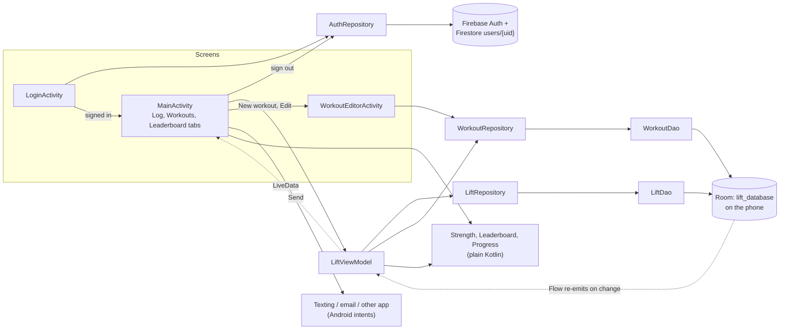

# Developer Guide: MSU Lift Tracker

This guide is for a developer joining the project. By the end you should have a working build, know where the code for each feature lives, and know how to test a change and submit it.

> **Documented version:** the Beta Demo build on the `main` branch (October 2026). The Android project is in `App-0.8.0/`. The build file reports `versionName "0.8.0"` / `versionCode 8`, matching the folder.

**Contents:** [At a glance](#at-a-glance) · [Set up](#set-up) · [Build and run](#build-and-run) · [Understand the code](#understand-the-code) · [Test a change](#test-a-change) · [Troubleshoot](#troubleshoot)

How to propose and submit work (issues, branches, pull requests) is in the [README](../README.md#contributing). The guide for app users is [user.html](user.html).

---

## At a glance

| | |
|---|---|
| Platform | Android app, one Gradle module (`:app`), package `com.example.liftingapp` |
| Language and UI | Kotlin, Android Views with ViewBinding, Material 3 (no Jetpack Compose) |
| Sign-in | Firebase Authentication: email and password, or Google through Android Credential Manager |
| Lift data | Room (SQLite) database on the phone. It isn't synced, and it isn't separated by account. |
| Cloud data | Cloud Firestore holds one profile document per user (`users/{uid}`), and nothing else yet |
| Charts | MPAndroidChart v3.1.0 (from JitPack) |
| Build | Android Gradle Plugin 9.4.1, Gradle wrapper 9.6.0, KSP 2.3.6, Google Services plugin 4.4.4 |
| Android versions | `minSdk` 24 (Android 7.0), `targetSdk` 36, `compileSdk` 37 |
| Tests | 12 JVM unit tests. The one instrumented test doesn't compile yet. |
| CI | None: every check runs on your machine |

---

## Set up

### Required tools

| Tool | Version | Notes |
|---|---|---|
| Git | Any recent version | Used to clone the repo. |
| Android Studio | A release that supports **AGP 9.4.1** and **compileSdk 37** | If sync says the Android Gradle Plugin is newer than Studio supports, update Android Studio. |
| JDK | **25**, for running Gradle | Set in `App-0.8.0/gradle/gradle-daemon-jvm.properties`. If JDK 25 isn't installed, Gradle downloads it on the first sync. The app code itself compiles to Java 17. |
| Android SDK | **Platform 37** plus Platform-Tools | Install them from Android Studio: **Tools → SDK Manager**. |
| Device | Android 7.0 (API 24) or newer, emulator or phone | For Google sign-in, use a **Google Play** emulator image and sign in to a Google account on the device. |
| Internet | Needed for the first sync and for signing in | Gradle downloads from Google Maven, Maven Central and JitPack. The app's sign-in talks to Firebase. |

You don't install any libraries by hand. Gradle downloads everything declared in `App-0.8.0/app/build.gradle.kts`:

- Firebase BoM 34.4.0 (Auth, Firestore)
- Credential Manager 1.5.0 and Google ID 1.1.1
- Room 2.8.4
- Lifecycle 2.11.0
- Material 1.13.0
- MPAndroidChart v3.1.0

**External service:** the Firebase project `liftingapp-9c495` provides Authentication and Cloud Firestore. It's already wired in through `App-0.8.0/app/google-services.json`. The team doesn't run any server of its own.

### Get the code

```powershell
git clone https://github.com/423F26/project4.git
cd project4\App-0.8.0
dir
```

Expected: the folder lists `settings.gradle.kts`, `build.gradle.kts`, `gradlew.bat` and `app`.

The parts of the repo you'll use:

```text
project4/
├── README.md             start here
├── index.html            GitHub Pages homepage (links to the user guide)
├── docs/                 developer.md (this file) and user.html (user guide)
├── docs & agile/         sprint records (Sprints/) and the earlier code reviews
├── Agents/               prompts for the team's AI review agents
└── App-0.8.0/            the Android project; open THIS folder in Android Studio
    ├── settings.gradle.kts, build.gradle.kts, gradle.properties, gradlew, gradlew.bat
    ├── gradle/wrapper/   Gradle wrapper (9.6.0)
    └── app/              the app module: build.gradle.kts, google-services.json, src/
```

### Open the project in Android Studio

1. **File → Open**, then select the **`project4\App-0.8.0`** folder (the one that contains `settings.gradle.kts`).

   Don't open the `project4` root. Its committed `.idea/gradle.xml` still points at the deleted `423-4/LIFTINGAPP` folder, so the sync fails with "run 'gradle init'" (see [Troubleshoot](#sync-says-to-create-a-new-gradle-build-in-this-directory-run-gradle-init)).
2. Click **Trust Project** if asked, then wait for the Gradle sync. The first sync downloads Gradle 9.6.0, JDK 25 if needed, and all dependencies, so it can take several minutes.
3. **Success:** the Build window shows the sync finished with no errors, and the run-configuration dropdown in the toolbar shows **app**.

### Configuration

There are no environment variables. Configuration lives in these files:

| File | What it holds | In git? | What you do |
|---|---|---|---|
| `App-0.8.0/local.properties` | `sdk.dir`, the path to your Android SDK | No (`.gitignore`) | Android Studio creates it on the first sync. Create it yourself only if you build from the command line without ever opening Studio. |
| `App-0.8.0/app/google-services.json` | Firebase project ID, app ID and API key | Yes | Nothing. Replace it only if the team moves to a different Firebase project. |
| `google_web_client_id` in `App-0.8.0/app/src/main/res/values/strings.xml` | The OAuth "Web client ID" used for Google sign-in | Yes | Nothing. It must match **Firebase console → Authentication → Sign-in method → Google → Web SDK configuration**. |
| `App-0.8.0/gradle.properties` | Gradle memory and configuration-cache settings | Yes | Nothing. |

Example `local.properties` (use your own user name, and don't commit it):

```properties
# Windows
sdk.dir=C\:\\Users\\YOUR_WINDOWS_USER\\AppData\\Local\\Android\\Sdk
# macOS
# sdk.dir=/Users/YOUR_MAC_USER/Library/Android/sdk
```

The Firebase API key and the web client ID are **not secrets**. They identify the app to Google. Access is controlled by Firebase Authentication, the registered signing-key fingerprints, and Firestore security rules.

Never commit real secrets: signing keystores (`*.jks`, `*.keystore`), passwords, Firebase Admin or service-account JSON files.

### Private access

**What works with no special access:** cloning (the repo is public), building, running, and **email/password** sign-in. Signing up creates a real account in the team's Firebase project, so use an email address you control.

**What needs a teammate:**

- **Google sign-in on your build.** Google only accepts sign-ins from builds whose signing-key fingerprint is registered in Firebase. Your debug key is unique to your computer. From `App-0.8.0`, run:

  ```powershell
  .\gradlew.bat signingReport
  ```

  Find the block that starts with `Variant: debug` and copy its `SHA1:` value (it looks like `AB:CD:12:...`). Send the value to a teammate who has Firebase access. They add it under **Firebase console → Project settings → Your apps → Android app `com.example.liftingapp` → Add fingerprint**. The fingerprint isn't secret, so you can paste it in an issue or chat.
- **Firebase console access** (to see test accounts, sign-in providers, or Firestore data). Ask Garrett Miller or Gaige Bache to add your Google account to project `liftingapp-9c495` under **Project settings → Users and permissions**. Never put passwords or keys in issues, docs or commits.

### Database and sample data

The app uses two stores. Neither needs setup.

**1. Room, on the phone.** This holds the athletes, their lifts and the workout library.

- Room creates `lift_database` (schema version 3) the first time the app opens. Its tables are `athletes`, `lift_entries`, `workouts` and `workout_exercises`; see [Data model](#data-model).
- Phones on version 2 (the first Beta builds) are upgraded by `MIGRATION_2_3` in `data/LiftDatabase.kt`, which keeps every athlete and set. Only pre-Beta version 1 databases are still wiped.
- The only seed data is the six premade workouts in `data/PremadeWorkouts.kt`. They're copied into the database once, on a fresh install or by the 2 → 3 migration. After that they're ordinary rows (marked `isPremade`) that coaches can edit or delete. There are no seed athletes or lifts. To build a small sample set, sign in and enter:

  | Step | Enter | What you should see |
  |---|---|---|
  | 1 | **Add athlete:** `Jordan Smith`, `OL`, `285` | Jordan is selected in the Athlete picker |
  | 2 | **Log set:** Bench `225` × `5`, then Bench `205` × `8` | The dialog previews "Estimated 1RM: 263 lb" for 225 × 5 |
  | 3 | **Add athlete:** `Sam Lee`, `DB`, `180`. **Log set:** Bench `185` × `5` | |
  | 4 | Open the **Leaderboard** tab | Estimated max ranks Jordan first (263 lb). Pound-for-pound ranks Sam first (1.20× BW vs 0.92× BW). |
  | 5 | Open the **Workouts** tab | Six premade workouts, each with a **Premade** badge. **Mine** says you haven't made one yet. |

- Every set is stamped with the current date and time, so everything you log in one day becomes one chart point. To see a multi-day chart, log sets on different days, or change the emulator's date under **Settings → System → Date & time**.
- To look at the tables while the app runs, use **View → Tool Windows → App Inspection → Database Inspector**.
- To reset everything, uninstall the app, or use **Settings → Apps → LIFTING APP → Storage → Clear storage**. Either one also signs you out.

**2. Cloud Firestore, in Firebase.** This holds only a profile document per user, at `users/{uid}`, with these fields:

- `name`
- `email`
- `role` (always `"athlete"`)
- `createdAt` (a server timestamp)

It's written the first time someone signs up, or the first time they sign in with Google. Nothing in the app reads it yet.

---

## Build and run

There is **no deployed or packaged version**: no Play Store listing and no release APK. Every developer builds and installs a debug build from source, and the Beta Demo runs a debug build of `main`.

The only part of the app that runs online is Firebase, which Google hosts. Every debug build talks to the **same** Firebase project, so test accounts are real accounts. That's the only difference between "local" and "deployed" today.

### Run from Android Studio

1. **Start a device.** In **Device Manager**, create or start an emulator. A Pixel with an API 36 **Google Play** image is a good choice. Or plug in a phone with USB debugging turned on.
2. **Run the app.** Choose the **app** run configuration and your device, then click **Run ▶**.
3. **Check the sign-in screen.** It shows:
   - the logo and **LIFTING APP**
   - **Email** and **Password** fields
   - a **Sign in** button
   - **Continue with Google**
   - **New here? Create an account**

   That screen means the build, install and Firebase setup all worked.
4. **Create an account.** Tap **New here? Create an account**, then enter a name, an email address and a password of at least 6 characters. Tap **Create account**.
5. **Check the main screen.** It opens with the tabs **Log**, **Workouts** and **Leaderboard**. The Log tab shows "No athletes yet. Add one to start logging."
6. From now on the app skips the sign-in screen until you sign out, using the icon at the top right.

### Build from the command line (Windows PowerShell)

Run every Gradle command from inside **`App-0.8.0`**:

```powershell
cd C:\path\to\project4\App-0.8.0
.\gradlew.bat assembleDebug
```

Expected: the output ends with `BUILD SUCCESSFUL in …`, and the APK is at `app\build\outputs\apk\debug\app-debug.apk`.

To install on a running emulator, or on a connected phone:

```powershell
.\gradlew.bat installDebug
```

Expected: `Installed on 1 device.` followed by `BUILD SUCCESSFUL`. Open **LIFTING APP** from the device's app drawer.

On macOS or Linux, use `./gradlew` instead of `.\gradlew.bat`. If you get "permission denied", run `chmod +x gradlew` once.

---

## Understand the code

Kotlin paths below are relative to `App-0.8.0/app/src/main/java/com/example/liftingapp/`.

### Where things are

| Path | Responsibility |
|---|---|
| `LoginActivity.kt` | **Launcher activity.** Handles email sign-in and sign-up, password reset, and Google sign-in. If a user is already signed in, it goes straight to `MainActivity`. |
| `MainActivity.kt` | **Main screen.** Sends signed-out users back to `LoginActivity`. Hosts the three tabs, the theme picker and sign-out. |
| `LiftViewModel.kt` | State for the three tabs (selected athlete, exercise, chart range, workout filter, rank mode). Turns Room `Flow`s into `LiveData` and launches database writes. |
| `WorkoutEditorActivity.kt`, `WorkoutEditorViewModel.kt` | **Workout editor** (not exported). Creates or edits one workout: name, notes and an ordered exercise list. The ViewModel holds the draft so rotation doesn't lose it, and returns the saved workout's id and name to the Workouts tab. |
| `data/AuthRepository.kt` | Every Firebase Auth and Firestore call. Turns Firebase errors into messages the user can read. |
| `data/LiftRepository.kt` | The single entry point for lift data. A thin wrapper over the DAO. |
| `data/LiftDao.kt`, `data/LiftDatabase.kt` | Room queries, the database singleton, `MIGRATION_2_3` and the premade-workout seeding. |
| `data/Athlete.kt`, `data/LiftEntry.kt`, `data/LiftWithAthlete.kt` | The Room tables and the "set plus athlete" relation. |
| `data/Workout.kt`, `data/WorkoutDao.kt`, `data/WorkoutRepository.kt` | The `workouts` and `workout_exercises` tables, the "workout plus exercises" relation, and their queries. Saves, deletes and Undo restores are single transactions. |
| `data/WorkoutLibrary.kt` | Sorting and filtering for the Workouts tab (All / Premade / Mine), exercise-name suggestions, and the 20-set cap. |
| `data/WorkoutShare.kt` | The text that's sent (greeting, notes, numbered exercise lines), plus phone and email checks. |
| `data/PremadeWorkouts.kt` | The six workouts the app ships with. |
| `data/Strength.kt` | The exercise list, the 20-rep cap, and the Epley estimated one-rep max (e1RM). |
| `data/Leaderboard.kt` | Leaderboard ranking. |
| `data/Progress.kt` | Builds the progress-chart series. |
| `ui/LogTab.kt`, `ui/ProgressChart.kt`, `ui/Dialogs.kt` | The Log tab: athlete and exercise pickers, progress chart, and the log, edit, delete and undo flows. `Dialogs.kt` also holds the add-athlete dialog and the workout editor's add/edit-exercise dialog. |
| `ui/WorkoutsTab.kt`, `ui/SendWorkout.kt` | The Workouts tab (filter, workout cards, delete with Undo) and the Send dialog (pick an athlete, then Text, Email or another app). |
| `ui/LeaderboardTab.kt` | The Leaderboard tab and its list adapter. |
| `ui/AppTheme.kt`, `ui/Format.kt`, `ui/Widgets.kt` | Themes, number and date formatting, small view helpers. |

Other important files:

- **Manifest** (`App-0.8.0/app/src/main/AndroidManifest.xml`): `LoginActivity` is the launcher. `MainActivity` and `WorkoutEditorActivity` aren't exported. The app asks for no SMS or contacts permission: sending hands the message to another app.
- **Layouts** (`res/layout/`): `activity_login.xml`, `activity_main.xml`, `activity_workout_editor.xml`, `tab_log.xml`, `tab_workouts.xml`, `tab_leaderboard.xml`, plus the `dialog_*.xml` and `item_*.xml` files.
- **Values** (`res/values/`): strings, colors, themes and type styles.
- **Tests:** `App-0.8.0/app/src/test/java/com/example/liftingapp/`.

### How the pieces fit



### Walk-through: signing in

1. **Already signed in?** `LoginActivity.onCreate()` checks `AuthRepository.currentUser`. If someone is signed in, `openMain()` starts `MainActivity` and finishes the login screen.
2. **Email.** `submit()` checks the form first: a name is required when signing up, the email must be valid, and the password needs at least 6 characters. It then calls `AuthRepository.signIn()` or `signUp()`. On success it opens `MainActivity`; on failure it shows the error message in a snackbar.
3. **Google.** `signInWithGoogle()` builds a `GetSignInWithGoogleOption` from `google_web_client_id` and asks `CredentialManager` for a credential. It reads the Google ID token and passes it to `AuthRepository.signInWithGoogle()`.
4. **Profile.** On the first sign-up or first Google sign-in, `AuthRepository` writes `users/{uid}` in Firestore. If that write fails, the user is let in anyway.
5. **Signing out.** `MainActivity.confirmSignOut()` calls `AuthRepository.signOut()`, clears the Credential Manager state so the Google account picker shows again, and returns to `LoginActivity`.

### Walk-through: logging a set (the main feature)

1. **Tap Log set.** `LogTab.onAddSetClicked()` looks up the selected athlete. If there's none, it opens the add-athlete dialog instead.
2. **Check the input.** `showLogSetDialog()` in `ui/Dialogs.kt` keeps **Save** disabled until the weight is above 0 and the reps are between 1 and `MAX_REPS` (20). While you type, it previews the estimate from `Strength.estimatedOneRepMax()`.
3. **Save.** **Save** calls `LiftViewModel.addEntry()`, which runs `viewModelScope.launch { repository.insert(...) }`. That ends in `LiftDao.insertLift()`, and Room does the write off the main thread.
4. **Room tells the screens.** Room re-emits every query that reads `lift_entries`:
   - `getProgress` updates the Log chart
   - `getLiftsForExercise` updates the Leaderboard

   The ViewModel exposes these as `entries` and `leaderboard` LiveData.
5. **The tabs redraw.** `LogTab.drawChart()` calls `LineChart.showProgress()` in `ui/ProgressChart.kt`, which uses `dailyBests()` and `progressWindow()` from `data/Progress.kt`. The Leaderboard uses `buildLeaderboard()` from `data/Leaderboard.kt`. Nothing calls "refresh": Room's `Flow`s drive every update.

### Walk-through: making and sending a workout

1. **New workout or Edit.** `WorkoutsTab.openEditor()` starts `WorkoutEditorActivity` for a result. `WorkoutEditorViewModel.start()` loads the workout once (or starts a blank one), so rotating doesn't reload it.
2. **Exercises.** **Add exercise** and tapping a row open `showExerciseDialog()` in `ui/Dialogs.kt`. Its **Add**/**Save** button stays disabled until there's a name, 1–20 sets and reps. Each row's ⋮ menu moves it up or down or removes it (with Undo).
3. **Save.** The activity checks for a name and at least one exercise, then `WorkoutEditorViewModel.save()` calls `WorkoutDao.save()`. That inserts or updates the workout and replaces its exercise list in one transaction. The activity returns the id and name; the tab shows "Saved" with a **Send** action.
4. **Send.** `showSendWorkoutDialog()` in `ui/SendWorkout.kt` fills in the picked athlete's phone and email and previews `WorkoutShare.message()`. **Text** opens an `ACTION_SENDTO smsto:` intent, **Email** an `ACTION_SENDTO mailto:` intent, and **Send with another app** the system share sheet. The coach still taps send in that app. Any phone or email typed for the athlete is saved back with `LiftViewModel.updateAthlete()`.
5. **Delete.** `WorkoutsTab.delete()` deletes the workout (its exercises cascade) and keeps a copy for the snackbar's **Undo**, which re-inserts it with the same ids.

### Design decisions to know

- **The lift data is local and shared by every account on the phone.** Signing in controls who can open the app, but the athletes and lifts live in one Room database on the device. They aren't tied to the account and don't sync. Moving them to the cloud is backlog work (Sprint 2 Product Backlog items 3–4). Don't mistake this for a sign-in bug.
- **One main activity, with the tabs as included layouts.** `activity_main.xml` `<include>`s `tab_log`, `tab_workouts` and `tab_leaderboard`, and `MainActivity` shows or hides them. The workout editor is its own activity because it's a full form. They aren't Fragments. Because all three share one view hierarchy, **view IDs must be unique across the tab layouts**. Both `tab_log.xml` and `tab_leaderboard.xml` use `exerciseSpinner`, which is a known bug.
- **Views and ViewBinding, not Compose.** The Sprint 1 records mention Compose, but the code doesn't use it.
- **The e1RM is never stored.** Every screen calculates it from weight and reps with Epley: `weight × (1 + reps / 30)`, or just the weight for a single rep. The log dialog limits reps to 1–20, because the estimate is unreliable above that.
- **Exercise names are stored as plain text.** Add new lifts to `EXERCISES` in `data/Strength.kt`. Don't rename an existing one: old rows keep the old name.
- **Schema changes need a `Migration`.** Version 3 added the workout tables with `MIGRATION_2_3`, which keeps existing data. `fallbackToDestructiveMigration(dropAllTables = true)` is still set, so a version bump *without* a matching migration deletes all local data. Add a `MIGRATION_3_4` (and match Room's generated SQL exactly) for the next schema change.
- **Premade workouts are data, not code paths.** They're seeded once and then behave like any workout. Editing `PREMADE_WORKOUTS` only changes what new installs get.
- **Sending never happens inside the app.** Text and Email open the phone's own apps with the message filled in, so the app needs no SMS permission and the coach always sees the message before it goes. The shared text uses a plain "x" (not "×") to keep carrier texts in the cheaper encoding.
- **Testable logic stays plain Kotlin.** `Strength.kt`, `Leaderboard.kt`, `Progress.kt`, `WorkoutLibrary.kt`, `WorkoutShare.kt` and `PremadeWorkouts.kt` have no Android imports, so they run in fast JVM tests. Put new calculation logic there.
- **Themes.** Both activities call `setTheme()` before inflating views. The choice is saved in the SharedPreferences file `appearance`, under the key `theme`.

### Interfaces

**`AuthRepository`** (`data/AuthRepository.kt`). Callbacks run on the main thread. Errors arrive as messages that are ready to show to the user.

| Member | Inputs | On success | On failure |
|---|---|---|---|
| `currentUser` | none | The `FirebaseUser`, or `null` when signed out | none |
| `signIn(email, password, onSuccess, onError)` | email, password | `onSuccess(user)` | `onError(message)` |
| `signUp(name, email, password, onSuccess, onError)` | name, email, password | Creates the account, writes `users/{uid}`, then calls `onSuccess(user)` (even if the profile write failed) | `onError(message)` |
| `signInWithGoogle(idToken, onSuccess, onError)` | A Google ID token from Credential Manager | Signs in, creates `users/{uid}` on first sign-in, then calls `onSuccess(user)` | `onError(message)` |
| `sendPasswordReset(email, onDone)` | email | `onDone("Reset link sent to {email}")` | `onDone(message)` |
| `signOut()` | none | Signs out of Firebase | none |

The error messages come from `friendlyMessage()`:

| Firebase exception | Message shown |
|---|---|
| `FirebaseAuthWeakPasswordException` | "Password must be at least 6 characters." |
| `FirebaseAuthUserCollisionException` | "An account with that email already exists. Try signing in another way." |
| `FirebaseAuthInvalidUserException` | "No account found with that email." |
| `FirebaseAuthInvalidCredentialsException` | "Email or password is incorrect." |
| Anything else | Firebase's own message, or "Something went wrong. Check your connection." |

**`LiftRepository` and `LiftDao`** (`data/`). Reads return a `Flow` that re-emits whenever its tables change. Writes are `suspend` functions.

| Repository member | DAO method and SQL | Returns |
|---|---|---|
| `athletes` | `getAthletes()`: `SELECT * FROM athletes ORDER BY name COLLATE NOCASE` | `Flow<List<Athlete>>` |
| `progressFor(athleteId, exercise)` | `getProgress()`: one athlete's sets for one exercise, `ORDER BY date ASC` | `Flow<List<LiftEntry>>` |
| `liftsFor(exercise)` | `getLiftsForExercise()`: every set for one exercise | `Flow<List<LiftWithAthlete>>` |
| `addAthlete(name, positionGroup, bodyWeightLb, phone, email)` | `insertAthlete()`; phone and email are optional | The new athlete's id (`Long`) |
| `updateAthlete(athlete)` | `updateAthlete()`, matching on the `id`. Only the Send dialog uses it, to save phone and email. | `Unit` |
| `insert(entry)`, `update(entry)`, `delete(entry)` | `insertLift()`, `updateLift()`, `deleteLift()`; update and delete match on the `id` | `Unit` |

There's no screen to edit an athlete's name, position or body weight, or to delete an athlete, yet.

**`WorkoutRepository` and `WorkoutDao`** (`data/`). `WorkoutDao` is an abstract class so its multi-step writes can be `@Transaction` methods.

| Repository member | DAO method | Returns |
|---|---|---|
| `workouts` | `getWorkouts()`: every workout with its exercises, sorted by `position` | `Flow<List<WorkoutWithExercises>>` |
| `workout(id)` | `getWorkout(id)` | `WorkoutWithExercises?` (`null` if it was deleted) |
| `save(workout, exercises)` | `save()`: inserts the workout when its id is 0, otherwise updates it; then replaces its exercises in list order | The workout's id (`Long`) |
| `delete(workout)` | `deleteWorkout()`; its exercises go with it (`ON DELETE CASCADE`) | `Unit` |
| `restore(item)` | `restore()`: re-inserts a deleted workout and its exercises with their old ids (Undo) | `Unit` |

**Calculation functions** (`data/`). These are covered by unit tests.

| Function | What it does | Errors |
|---|---|---|
| `Strength.estimatedOneRepMax(weight, reps)` | Epley e1RM. A single rep returns the weight itself. | Throws `IllegalArgumentException` when `reps < 1`. It doesn't enforce the 20-rep cap; the dialog does. |
| `buildLeaderboard(lifts, rankBy)` | One row per athlete, using their best set by e1RM. Sorted highest first, by e1RM or by e1RM ÷ body weight. | none |
| `dailyBests(entries, zone)` | One chart point per calendar day: the best e1RM and the heaviest weight that day. | none |
| `progressWindow(days, range, today)` | The days shown for 1M, 3M, 6M, 1Y or All. "All" always covers at least 14 days. | none |
| `workoutLibrary(workouts, filter)` | The Workouts tab list: the coach's own workouts newest first, then premade ones in shipped order. `PREMADE` and `MINE` keep just one group. | none |
| `WorkoutShare.message(workout, exercises, athleteName)` | The text that's sent: "Hi {first name}, here's your workout: …" (or "Workout: …"), the notes, then numbered lines like "1. Bench: 5 x 5 @ 75%" with any cue underneath. | none |
| `isValidPhone(raw)`, `isValidEmail(raw)`, `dialablePhone(raw)` | Blank is valid (both are optional). A phone needs 7–15 digits. `dialablePhone` keeps just the digits and a leading +. | none |

### Data model

| Table | Columns |
|---|---|
| `athletes` | `id` (primary key, auto-generated), `name`, `positionGroup` (stored upper-case), `bodyWeightLb`, `phone` (optional), `email` (optional) |
| `lift_entries` | `id` (primary key, auto-generated), `athleteId` (foreign key to `athletes.id`, indexed, `ON DELETE CASCADE`), `exercise`, `weight` (lb), `reps`, `date` (epoch milliseconds) |
| `workouts` | `id` (primary key, auto-generated), `name`, `notes`, `isPremade`, `createdAt`, `updatedAt` (epoch milliseconds) |
| `workout_exercises` | `id` (primary key, auto-generated), `workoutId` (foreign key to `workouts.id`, indexed, `ON DELETE CASCADE`), `position` (0 first), `name`, `sets`, `reps` (text, e.g. "8-10"), `load` (text, e.g. "75%"), `notes` |
| Firestore `users/{uid}` | `name`, `email`, `role`, `createdAt` |

---

## Test a change

### Unit tests (required)

There are 12 JVM tests in `App-0.8.0/app/src/test/java/com/example/liftingapp/`. They need no emulator and no test data. Run them from `App-0.8.0`:

```powershell
.\gradlew.bat :app:testDebugUnitTest
```

Passing looks like `BUILD SUCCESSFUL`. The HTML report is at `app\build\reports\tests\testDebugUnitTest\index.html` and shows **12 tests, 0 failures**. When a test fails, Gradle prints `FAILED`, the test name, and a link to the report.

To run one class:

```powershell
.\gradlew.bat :app:testDebugUnitTest --tests "com.example.liftingapp.data.LeaderboardTest"
```

To run them in Android Studio, right-click the `test` source folder (`app/src/test/java`) and choose **Run 'Tests in …'**.

| Test file | What it covers |
|---|---|
| `data/StrengthTest.kt` | The Epley e1RM, the single-rep case, and that 0 reps is rejected |
| `data/LeaderboardTest.kt` | One row per athlete, ranking by e1RM, and that pound-for-pound flips the order |
| `data/ProgressTest.kt` | One point per day, the All, 1M and 14-day windows, and the time-zone handling of calendar days |
| `ExampleUnitTest.kt` | Android Studio's template test (2 + 2 = 4) |

When you add or change logic in `data/Strength.kt`, `Leaderboard.kt` or `Progress.kt`, add or update a test in the matching file.

### Lint (recommended)

```powershell
.\gradlew.bat lintDebug
```

The report goes to `app\build\reports\lint-results-debug.html`. Run lint when you change layouts, resources or the manifest, and fix any new warnings your change adds. Lint isn't one of the required checks yet.

### Instrumented tests (currently broken)

`app/src/androidTest/.../ExampleInstrumentedTest.kt` doesn't compile. It imports AndroidX Test, but `app/build.gradle.kts` declares no `androidTestImplementation` dependencies and sets no `testInstrumentationRunner`. As a result, `connectedAndroidTest` fails.

This doesn't affect `assembleDebug` or the unit tests. To enable instrumented tests, add these lines to `app/build.gradle.kts`:

```kotlin
// in defaultConfig { }
testInstrumentationRunner = "androidx.test.runner.AndroidJUnitRunner"
// in dependencies { }
androidTestImplementation("androidx.test.ext:junit:1.3.0")
androidTestImplementation("androidx.test:runner:1.7.0")
```

### What CI runs

There's **no CI**: the repo has no `.github/workflows/`, so nothing runs automatically on a push or a pull request. The PR author runs the checks below locally and says so in the PR description.

### Checks required before merging

1. `.\gradlew.bat assembleDebug` succeeds.
2. `.\gradlew.bat :app:testDebugUnitTest` passes.
3. You did a manual smoke test of every screen you changed (list below).
4. Any docs your change affects are updated in the same PR.

### Manual smoke test

Run this on an emulator after a fresh install:

1. **Create an account.** The sign-in screen appears. Tap **New here? Create an account**, enter a name, email and password, and tap **Create account**. The Log tab opens.
2. **Sign out and back in.** Tap the sign-out icon (top right), then **Sign out**. Sign in again with a wrong password and check you see "Email or password is incorrect." Then sign in with the right password.
3. **Add an athlete.** Tap **Add athlete**. **Add** should stay disabled until the name, position and a body weight above 0 are all filled in. After you add the athlete, they're selected.
4. **Log a set.** Tap **Log set** and type 25 reps: you should see "Enter 1–20 reps" and a disabled **Save**. Then enter 225 × 5. Check the preview says "Estimated 1RM: 263 lb", and save.
5. **Check every tab.** The chart shows a point, the Workouts tab lists six premade workouts, and the Leaderboard ranks the athlete in both modes.
6. **Make a workout.** On **Workouts**, tap **New workout**. **Save** with no name should flag the name field, and with no exercises should say "Add at least one exercise". Add two exercises, move one with its ⋮ menu, rotate the phone (nothing is lost), and save. It appears first under **All** and **Mine**.
7. **Send it.** Tap **Send** on the "Saved" snackbar (or on the card). Pick the athlete, type a phone and email, and check the preview starts "Hi Jordan". **Text** should open the texting app with the message and number filled in; go back and check **Email** and **Send with another app** too. Reopen **Send**: the phone and email are filled in.
8. **Edit and delete a workout.** Edit a premade workout and save: it keeps its **Premade** badge. Back out of an edit with changes and check you're asked to discard. Delete a workout, tap **Undo**, and check it comes back in the same place.
9. **Edit and undo a set.** Tap the chart point, then **Edit or delete set from …**. Edit the set and tap **Undo**. Then delete it and tap **Undo** again.
10. **Ranges and themes.** Try each chart range button. Switch to each theme with the palette icon, and rotate the phone.

### Known gaps in testing

- There are no automated tests for sign-in (`AuthRepository`, `LoginActivity`), the Room queries and cascade delete, `MIGRATION_2_3`, `LiftViewModel`, the workout editor, the dialogs, the send intents, or chart drawing. Test the migration by installing the previous Beta build, logging some sets, then installing this one over it: the sets must still be there and the six premade workouts must appear.
- Testing so far has been on one emulator. Multi-device testing is still open (Product Backlog item 14).
- There's no CI.

---

## Troubleshoot

### Sync says "To create a new Gradle build in this directory run 'gradle init'"

Android Studio is syncing a folder that has no `settings.gradle.kts`. This usually happens because someone opened the `project4` root, whose committed `.idea/gradle.xml` links three Gradle projects under `423-4/LIFTINGAPP`, a folder that no longer exists.

1. **Close it.** Choose **File → Close Project**.
2. **Open the right folder.** Choose **File → Open** and pick **`App-0.8.0`**.
3. **Remove stale links.** If Studio still syncs the wrong place, open the **Gradle** tool window (the elephant icon on the right edge). Right-click any project pointing at `423-4` and choose **Unlink Gradle Project**. Then click **+** and pick `App-0.8.0/settings.gradle.kts`.
4. **Check the Gradle user home.** Go to **Settings → Build, Execution, Deployment → Build Tools → Gradle**. **Gradle user home** should be empty, which means the default `C:\Users\<you>\.gradle`. If it points at a folder inside the repo, Gradle fills that folder with `caches`, `daemon`, `native`, `wrapper/dists` and `.tmp` folders.
5. **Clean up.** If a `423-4` folder appeared in your clone, Studio created it; delete it.

### Gradle-generated folders appear inside `App-0.8.0` (`caches`, `daemon`, `native`, `.tmp`, a top-level `wrapper`)

This is the same wrong "Gradle user home" setting described in step 4 above. Fix the setting, then delete those folders. Don't commit them.

Keep `App-0.8.0/gradle/wrapper/`. That's the real wrapper.

### "SDK location not found"

`local.properties` is missing or points at someone else's SDK. Open the project in Android Studio once (it writes the file for you), or create the file as shown in [Configuration](#configuration).

### Errors about Java 25 or the "Daemon JVM criteria"

Gradle is set to run on JDK 25 (`gradle/gradle-daemon-jvm.properties`). Either let it download JDK 25 (this needs internet), or install a JDK 25 and select it under **Settings → Build, Execution, Deployment → Build Tools → Gradle → Gradle JDK**. Errors that mention class-file versions mean the JDK running Gradle is too old.

### "Could not resolve com.github.PhilJay:MPAndroidChart:v3.1.0"

This library only exists on JitPack. Check that `maven { url = uri("https://jitpack.io") }` is still in `settings.gradle.kts`, and that your network allows `jitpack.io`.

### "File google-services.json is missing"

The Google Services Gradle plugin needs `App-0.8.0/app/google-services.json`. Restore it from git:

```powershell
git checkout -- app/google-services.json
```

### Sign-in problems

| What you see | Cause | What to do |
|---|---|---|
| "Email or password is incorrect." or "No account found with that email." | A wrong password, or no account exists | This is expected. Create an account, or use **Forgot password?** |
| "An account with that email already exists. Try signing in another way." | The email was registered another way, for example with Google | Sign in with that method instead. |
| "Something went wrong. Check your connection." or a raw Firebase message | The device is offline, or a sign-in provider is turned off in Firebase | Check the emulator's internet connection. Ask a teammate with Firebase access to check **Authentication → Sign-in method**. |
| "Google sign-in failed: No credentials available" (or similar) | The device has no Google account, or the image doesn't include Google Play | Use a Google Play emulator image, and add an account under **Settings → Passwords & accounts**. |
| "Google sign-in failed: …" mentioning the developer console or "reauth" | Your build's SHA-1 isn't registered in Firebase | Follow [Private access](#private-access). |
| No password-reset email arrives | Email delivery | Check spam. The reset only works for email/password accounts. |

### My data disappeared

Local data is wiped when you uninstall the app, clear its storage, or install a build whose database version has no migration from yours (only pre-Beta version 1 databases now). Upgrading from version 2 to 3 keeps everything. This is expected during development.

### Unfinished behavior (not setup errors)

- **Shared lift data.** Different accounts on the same phone see the same athletes and lifts, and nothing syncs between phones.
- **No roles.** Every account gets `role: "athlete"`. The Workouts tab is meant for coaches, but every account can use it.
- **Workouts are on this phone only.** Workouts, like lifts, live in the local database and don't sync. Sending one hands the text to the phone's own texting or email app; the app doesn't record what was sent or to whom.
- **Little athlete editing.** The Send dialog can update an athlete's phone and email, but athletes otherwise can't be edited or deleted. A wrong body weight stays wrong.
- **Pounds only.** Weights are in pounds. Reps are limited to 1–20, and every exercise needs a weight above 0. That includes Pull-ups and Push-ups.

### Known bugs in the Beta

These are from the [Bug Check Report](../docs%20%26%20agile/Sprints/sprint%203/Bug%20Check%20Report%20-%20v0.5.0.md), which has the details and suggested fixes.

| Bug | Where |
|---|---|
| The solid "Est. max" chart line is very faint, and invisible in the Daylight theme | `ui/ProgressChart.kt` uses `colorOnPrimary` |
| The 1st-place badge number on the Leaderboard can't be seen | `ui/LeaderboardTab.kt`, the `first` badge colors |
| After you rotate the phone or change the theme, the Log tab switches to the Leaderboard's exercise | `tab_log.xml` and `tab_leaderboard.xml` share the ID `exerciseSpinner` |
| "Since …" never shows a drop in strength | `ui/ProgressChart.kt`, the gain calculation |
| Typing a decimal comma ("102,5") leaves **Save** disabled with no message | `ui/Dialogs.kt` |
| Rotating the phone closes any open dialog, and its typed text is lost. This includes the Send and add/edit-exercise dialogs (the workout editor screen itself keeps its draft). | `ui/Dialogs.kt`, `ui/LogTab.kt`, `ui/SendWorkout.kt` |

---

**Keeping this guide current:** update it in the same PR as any change to setup, commands, configuration, the code layout, or the known bugs.
